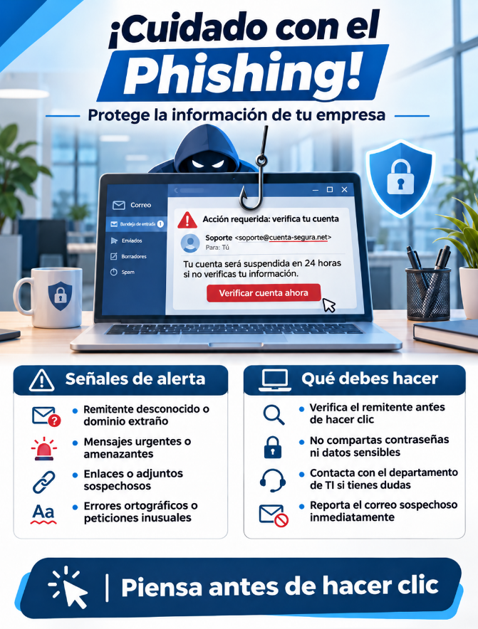
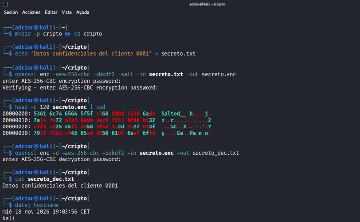
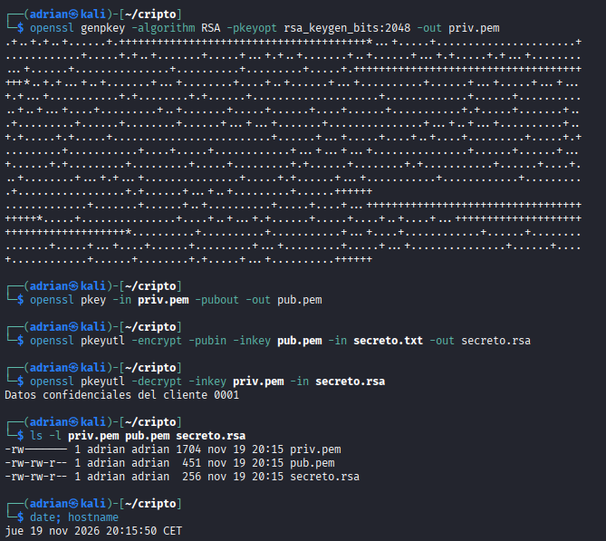
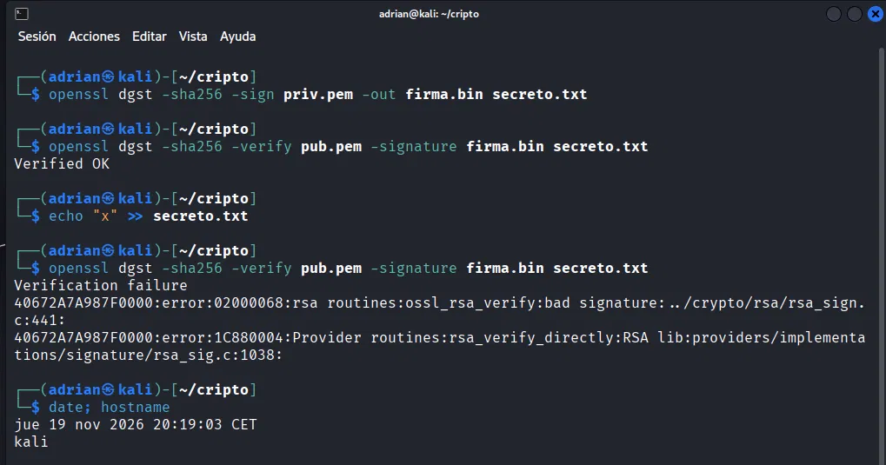
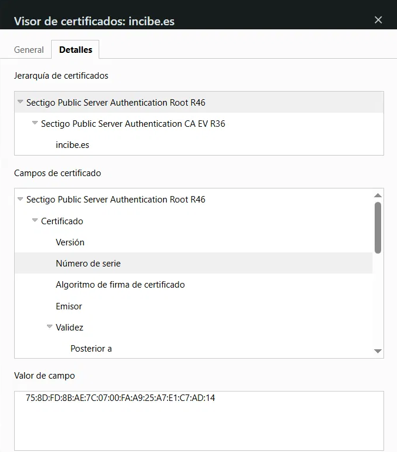
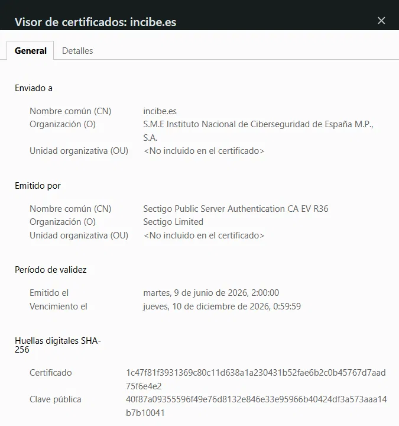
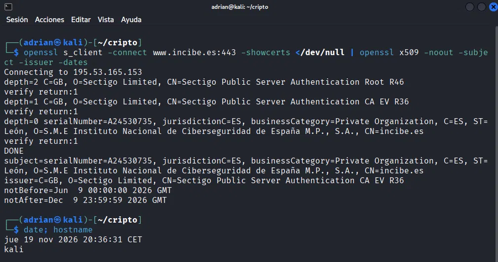
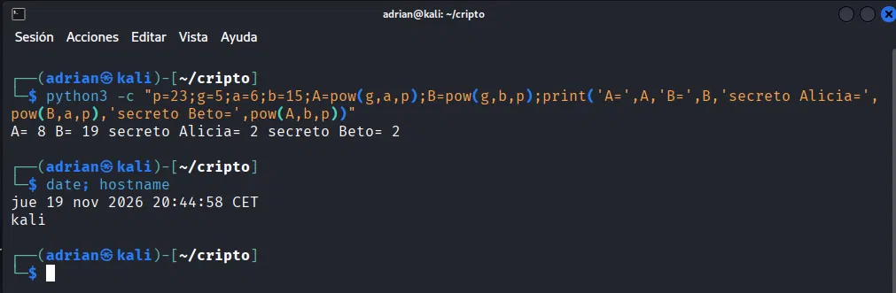

# 1. Prevención y concienciación

## 1.1 Principales riesgos y amenazas

El incidente es un ejemplo clásico de ingeniería social seguida de ejecución de malware. El análisis de riesgos de una empresa de este tamaño, sin procedimientos formales, arroja las siguientes amenazas prioritarias. Probabilidad (P) e Impacto (I) se valoran de 1 a 5.

| **Amenaza / riesgo** | **P** | **I** | **Descripción y vínculo con el caso** | **Control principal** |
|---|---|---|---|---|
| Phishing y spear-phishing | 5 | 4 | Correos que suplantan a RR. HH. Es el vector de entrada del incidente. | Filtrado de correo, SPF/DKIM/DMARC, formación |
| Malware (troyanos, ransomware, stealers) | 4 | 5 | Macro o ejecutable malicioso que descarga una segunda fase. | EDR/antivirus, macros bloqueadas, mínimo privilegio |
| Robo de credenciales | 4 | 5 | El atacante reutiliza credenciales para acceder a carpetas compartidas. | MFA, gestor de contraseñas, políticas de clave |
| Fuga de datos personales | 3 | 5 | Exfiltración de datos de clientes: sanciones RGPD y daño reputacional. | Cifrado, DLP, segmentación, control de accesos |
| Software sin actualizar | 4 | 4 | Vulnerabilidades conocidas aprovechables tras la ejecución inicial. | Gestión de parches |
| Permisos excesivos | 4 | 4 | Un usuario normal que puede ver carpetas de clientes amplía el daño. | Mínimo privilegio, revisión periódica de accesos |
| Ausencia de copias de seguridad fiables | 3 | 5 | Sin backups aislados, un ransomware paralizaría la empresa. | Regla 3-2-1, copias inmutables, pruebas de restauración |
| Amenaza interna (error o mala fe) | 3 | 4 | Empleado que reenvía datos o hace clic sin pensar. | Concienciación, registros, separación de funciones |
| Teletrabajo y dispositivos personales | 3 | 3 | Equipos fuera del perímetro, redes domésticas. | VPN, MDM, cifrado de disco |
| Falta de procedimiento de respuesta | 5 | 4 | Sin plan, la respuesta es lenta y desordenada (es el caso actual). | Plan de respuesta a incidentes (este trabajo) |

## 1.2 Normas de seguridad para los puestos de trabajo

Propuesta de normativa interna (política de uso aceptable), de obligado cumplimiento para toda la plantilla:

- **Contraseñas:** mínimo 12 caracteres, únicas para cada servicio, gestionadas con un gestor de contraseñas corporativo. Prohibido compartirlas o anotarlas.
- **Doble factor (MFA)** obligatorio en correo, VPN, aplicaciones de clientes y cuentas con privilegios.
- **Bloqueo de pantalla** (Windows+L) siempre que se abandone el puesto; bloqueo automático a los 5 minutos.
- **Correo electrónico:** no abrir adjuntos ni enlaces inesperados; las macros de Office permanecen **deshabilitadas**. Ante la duda, usar el botón «Reportar phishing» o escribir a seguridad.
- **Software:** solo se instala software autorizado por TI. Los usuarios no tienen permisos de administrador local.
- **Actualizaciones:** sistema operativo, navegador y ofimática se actualizan automáticamente. No se pospone un reinicio de parches más de 48 horas.
- **Antivirus/EDR** activo y no desactivable por el usuario. Toda alerta se comunica a TI.
- **Datos de clientes:** solo en las ubicaciones corporativas autorizadas. Prohibido copiarlos a USB, correo personal o servicios en la nube no autorizados.
- **Cifrado:** discos de portátiles cifrados (BitLocker) y soportes extraíbles cifrados.
- **Mesa limpia:** sin documentos con datos personales a la vista; destrucción segura de papel.
- **Teletrabajo:** conexión por VPN corporativa y redes WiFi domésticas con WPA2/WPA3 y clave robusta.
- **Notificación:** cualquier incidente o sospecha se comunica de inmediato a seguridad@solucionesdelta.example (ext. 1234). Comunicar a tiempo nunca será sancionado.

## 1.3 Plan de formación y concienciación

Un solo curso al año no cambia hábitos. El plan combina formación inicial, refuerzos breves y simulacros medibles durante 12 meses. Los simulacros de phishing se realizarían con herramientas como GoPhish, siempre con autorización de la dirección y sin sancionar a quien falle.

| **Acción** | **Público** | **Duración / formato** | **Frecuencia** |
|---|---|---|---|
| Sesión inicial «Seguridad básica»: phishing, contraseñas, MFA, datos personales | Toda la plantilla | 60 min, presencial/online | Al incorporarse y 1 vez al año |
| Microlecciones (vídeos de 3-5 min, tips por correo) | Toda la plantilla | 3-5 min | Mensual |
| Simulacro de phishing con informe individual y formación inmediata | Toda la plantilla | Campaña de 1-2 semanas | Trimestral |
| Formación específica RGPD y tratamiento de datos de clientes | Administración, atención al cliente, comerciales | 90 min | Anual |
| Formación técnica: logs, respuesta a incidentes, forense básico | Equipo TI y seguridad | 8 h taller | Semestral |
| Taller para dirección y ejercicio de mesa (como la simulación del apartado 6) | Dirección, DPO, legal, comunicación | 2 h | Anual |
| Cartel de phishing y guía de buenas prácticas (apartado 1.4) | Toda la plantilla | Impreso y en intranet | Permanente, renovado cada año |

**Indicadores para medir la eficacia:** porcentaje de empleados que hacen clic en el simulacro (objetivo: bajar del 25 % al 5 %), porcentaje que reporta el correo (objetivo: superar el 60 %), tiempo medio entre recepción y reporte, nº de incidentes por error humano y resultado de un test de conocimientos antes y después.

## 1.4 Cartel sobre phishing y guía de buenas prácticas

El cartel de la figura siguiente está pensado para imprimirse en A4/A3 y colocarse en zonas comunes y en las pantallas de la intranet.



**Cartel de concienciación.** *Cartel sobre phishing para imprimir en A4/A3 y colocar en zonas comunes y en la intranet.*

### Guía de buenas prácticas frente al phishing (una página)

| **Antes de hacer clic** | **Si dudas** | **Si ya has hecho clic** |
|---|---|---|
| Comprueba la dirección real del remitente, no solo el nombre.<br>Desconfía de la urgencia y de lo inesperado.<br>Pasa el ratón sobre los enlaces y revisa el dominio.<br>No habilites macros ni «contenido» en documentos recibidos por correo.<br>Comprueba la extensión del adjunto (.docm, .xlsm, .exe, .iso, .zip protegidos con clave).<br>Recuerda: RR. HH. no pide credenciales por correo. | No respondas, no reenvíes y no abras el adjunto.<br>Contacta con la persona o el departamento por otro canal.<br>Pulsa «Reportar phishing» o reenvía el correo **como adjunto** a seguridad.<br>Mantén el correo hasta que TI confirme.<br>Escribe la URL a mano en el navegador en vez de usar el enlace.<br>Usa MFA siempre: aunque roben la clave, no entrarán. | Desconecta el equipo de la red (cable o WiFi), sin apagarlo.<br>Avisa a TI inmediatamente.<br>Si introdujiste una contraseña, cámbiala desde otro equipo seguro.<br>No borres correos ni archivos.<br>Anota hora, qué abriste y qué ocurrió.<br>Colabora con TI; no se trata de buscar culpables. |

### Buenas prácticas generales

- Usa un gestor de contraseñas y activa MFA en todas las cuentas importantes.
- Mantén todo actualizado y no desactives el antivirus.
- Evita redes WiFi públicas sin VPN y no mezcles datos personales y corporativos.
- Haz copias de seguridad y comprueba de vez en cuando que se pueden restaurar.
- Comparte la información justa y solo con quien la necesita (principio de mínimo privilegio).

## 1.5 Criptografía aplicada a la seguridad de la empresa

La criptografía es la base técnica de varias medidas del plan. A continuación se explica cada concepto, su utilidad en la empresa y, cuando procede, una prueba práctica que realicé en VM-KALI. Antes preparé una carpeta de trabajo:

```bash
mkdir ~/cripto && cd ~/cripto
echo "Datos confidenciales del cliente 0001" > secreto.txt
```

### Cifrado simétrico

Se usa **la misma clave** para cifrar y descifrar (AES, ChaCha20). Es muy rápido, ideal para grandes volúmenes: discos de portátiles (BitLocker), copias de seguridad, bases de datos y túneles VPN. Su problema es la distribución segura de la clave: quien la tenga puede descifrar. En el caso, si los portátiles y el servidor de ficheros estuvieran cifrados y los datos de clientes protegidos, el impacto de una exfiltración sería menor.

```bash
openssl enc -aes-256-cbc -pbkdf2 -salt -in secreto.txt -out secreto.enc
head -c 120 secreto.enc | xxd            # contenido ilegible
openssl enc -d -aes-256-cbc -pbkdf2 -in secreto.enc -out secreto_dec.txt
cat secreto_dec.txt
date; hostname
```



**Captura 1.1.** *Cifrado simétrico AES-256-CBC con OpenSSL en VM-KALI (18/11/2026 19:03:56). El volcado hexadecimal del fichero cifrado (xxd) es ilegible y empieza por la cabecera «Salted\_\_»; al descifrar con la contraseña se recupera el texto original.*

### Cifrado asimétrico

Cada usuario tiene un **par de claves**: la pública (se reparte) y la privada (se guarda en secreto). Lo cifrado con la pública solo lo descifra la privada. Resuelve el problema de la distribución de claves y permite enviar datos confidenciales a alguien sin haber compartido un secreto antes. Es más lento, así que en la práctica se usa para intercambiar una clave simétrica (cifrado híbrido), como hace TLS. Algoritmos: RSA, ECC.

```bash
openssl genpkey -algorithm RSA -pkeyopt rsa_keygen_bits:2048 -out priv.pem
openssl pkey -in priv.pem -pubout -out pub.pem
openssl pkeyutl -encrypt -pubin -inkey pub.pem -in secreto.txt -out secreto.rsa
openssl pkeyutl -decrypt -inkey priv.pem -in secreto.rsa
ls -l priv.pem pub.pem secreto.rsa
date; hostname
```



**Captura 1.2.** *Par de claves RSA de 2048 bits y cifrado asimétrico en VM-KALI (19/11/2026 20:15:50). La clave privada priv.pem tiene permisos 600 y la pública pub.pem 644. El fichero secreto.rsa (256 bytes) solo se descifra con la clave privada y devuelve el texto original.*

### Funciones hash

Una función hash (SHA-256, SHA-3) transforma cualquier dato en una huella de longitud fija. Es **unidireccional** (no se puede invertir) y cualquier cambio mínimo en el dato altera por completo la huella (efecto avalancha). Utilidad: comprobar la integridad de ficheros y evidencias, identificar malware por su hash, almacenar contraseñas (con sal y algoritmos lentos como bcrypt/Argon2) y servir de base a las firmas digitales. La práctica con SHA-256 se desarrolla en el apartado 3.6.

### Firma electrónica

La firma electrónica garantiza **autenticidad** (quién firma), **integridad** (no se ha modificado) y **no repudio**. Se calcula el hash del documento y se cifra con la clave **privada** del firmante; cualquiera puede verificarlo con la clave pública. En la empresa sirve para firmar contratos, facturas, informes de incidentes y actas de custodia, o correos (S/MIME). Es la base del DNI electrónico y del certificado de empresa.

```bash
openssl dgst -sha256 -sign priv.pem -out firma.bin secreto.txt
openssl dgst -sha256 -verify pub.pem -signature firma.bin secreto.txt   # Verified OK
echo "x" >> secreto.txt
openssl dgst -sha256 -verify pub.pem -signature firma.bin secreto.txt   # Verification failure
date; hostname
```



**Captura 1.3.** *Firma digital con OpenSSL en VM-KALI (19/11/2026 20:19:03). La verificación da «Verified OK» con el fichero original y «Verification failure» (bad signature) después de añadirle un carácter.*

### Certificados digitales y PKI

Un **certificado digital** (X.509) vincula una clave pública con una identidad (persona, servidor o empresa) y está firmado por una **autoridad de certificación (CA)** de confianza. Una **PKI** (Public Key Infrastructure) es el conjunto de elementos que emite, distribuye, valida y revoca certificados: CA raíz y CA subordinadas, autoridad de registro (verifica la identidad), repositorio, listas de revocación (CRL) y OCSP. Cuando el navegador muestra el candado, valida la cadena servidor, CA intermedia y CA raíz, además de las fechas y la revocación. Utilidad en la empresa: HTTPS en servicios internos, VPN, autenticación de equipos y usuarios, correo firmado y cifrado, firma de documentos con el certificado de la FNMT. Ojo: un certificado válido no garantiza que un sitio sea legítimo: muchas webs de phishing también tienen HTTPS.

Para ver una cadena de certificación real analicé el certificado de incibe.es con el visor de certificados del navegador (capturas 1.4 a y b) y desde VM-KALI con openssl (captura 1.4 c):

```bash
openssl s_client -connect www.incibe.es:443 -showcerts </dev/null | openssl x509 -noout -subject -issuer -dates
date; hostname
```



**Captura 1.4 (a).** *Visor de certificados del navegador, pestaña Detalles: jerarquía de certificación de incibe.es, con la CA raíz Sectigo Public Server Authentication Root R46, la CA intermedia Sectigo Public Server Authentication CA EV R36 y el certificado del servidor.*



**Captura 1.4 (b).** *Visor de certificados, pestaña General: certificado emitido a incibe.es (S.M.E. Instituto Nacional de Ciberseguridad de España M.P., S.A.) por Sectigo CA EV R36, con periodo de validez del 9/6/2026 al 10/12/2026 y huellas digitales SHA-256.*



**Captura 1.4 (c).** *Comprobación de la cadena desde VM-KALI con openssl s_client (19/11/2026 20:36:31). Se ven los tres niveles (depth 2, 1 y 0), «verify return:1» en cada uno, el emisor y las fechas de validez.*

### Diffie-Hellman

Diffie-Hellman (DH) permite que **dos partes acuerden una clave secreta compartida a través de un canal inseguro** sin enviarla nunca. Cada parte elige un secreto privado; intercambian valores públicos derivados mediante exponenciación modular y ambas calculan el mismo secreto, imposible de deducir para un espía por el problema del logaritmo discreto. Utilidad: es la base del intercambio de claves de TLS (ECDHE), VPN (IPsec/WireGuard) y SSH, y proporciona *secreto perfecto hacia adelante* (PFS): si más tarde roban la clave del servidor, no se pueden descifrar sesiones pasadas.

Ejemplo con números pequeños (solo didáctico): p = 23, g = 5. Alicia elige a = 6 y envía A = 5<sup>6</sup> mod 23 = 8. Beto elige b = 15 y envía B = 5<sup>15</sup> mod 23 = 19. Alicia calcula 19<sup>6</sup> mod 23 = 2 y Beto 8<sup>15</sup> mod 23 = 2. La clave compartida es **2**.

```bash
python3 -c "p=23;g=5;a=6;b=15;A=pow(g,a,p);B=pow(g,b,p);print('A=',A,'B=',B,'secreto Alicia=',pow(B,a,p),'secreto Beto=',pow(A,b,p))"
```



**Captura 1.5.** *Diffie-Hellman con números pequeños en VM-KALI (19/11/2026 20:44:58): A = 8 y B = 19; Alicia y Beto obtienen el mismo secreto compartido, 2.*

### Resumen

| **Concepto** | **Qué garantiza** | **Uso en Soluciones Delta** |
|---|---|---|
| Cifrado simétrico (AES) | Confidencialidad, rápido | Cifrado de discos, copias de seguridad, datos de clientes |
| Cifrado asimétrico (RSA/ECC) | Confidencialidad sin compartir secreto previo | Intercambio de claves, correo cifrado (S/MIME, PGP) |
| Hash (SHA-256) | Integridad | Evidencias, verificación de descargas, identificación de malware |
| Firma electrónica | Autenticidad, integridad, no repudio | Contratos, facturas, informes y actas firmadas |
| Certificado digital | Vincula clave pública e identidad | HTTPS, VPN, autenticación, firma |
| PKI | Confianza y gestión del ciclo de vida de certificados | Emisión y revocación de certificados corporativos |
| Diffie-Hellman | Acuerdo de clave y PFS | Base de TLS, VPN y SSH |
