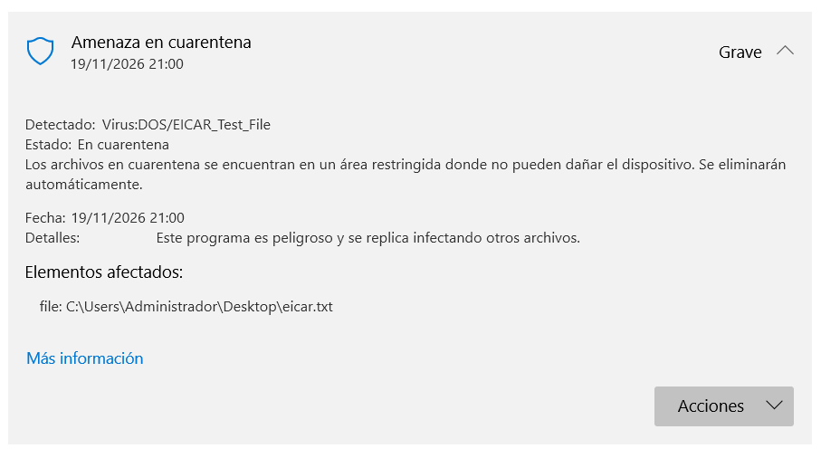
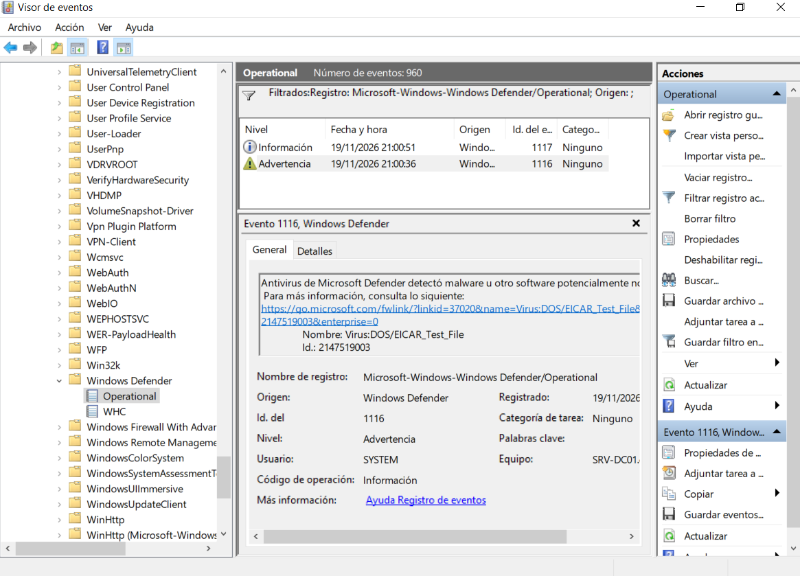
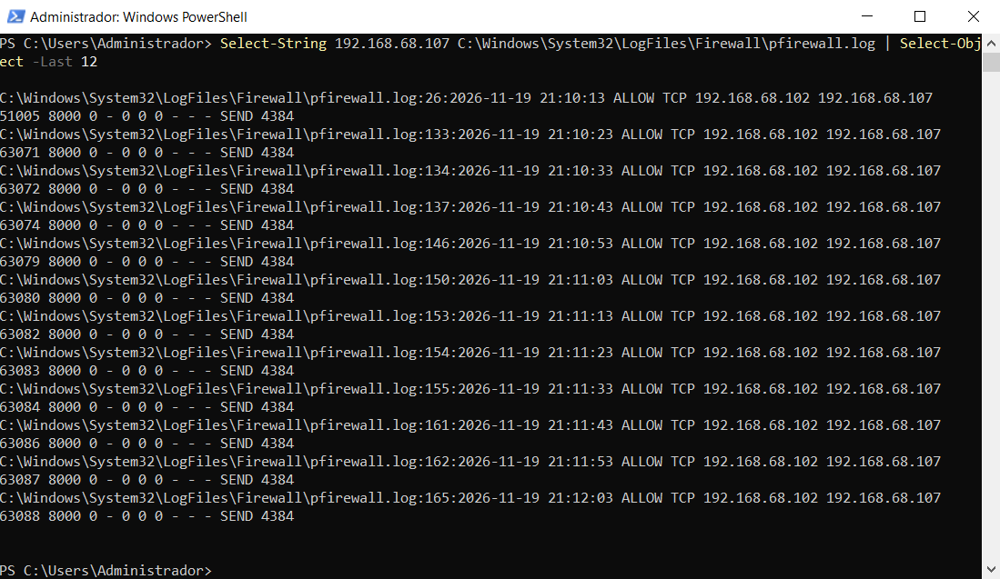
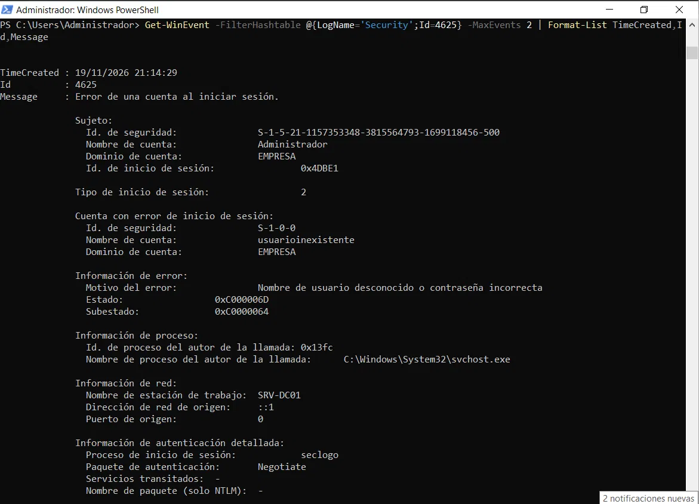
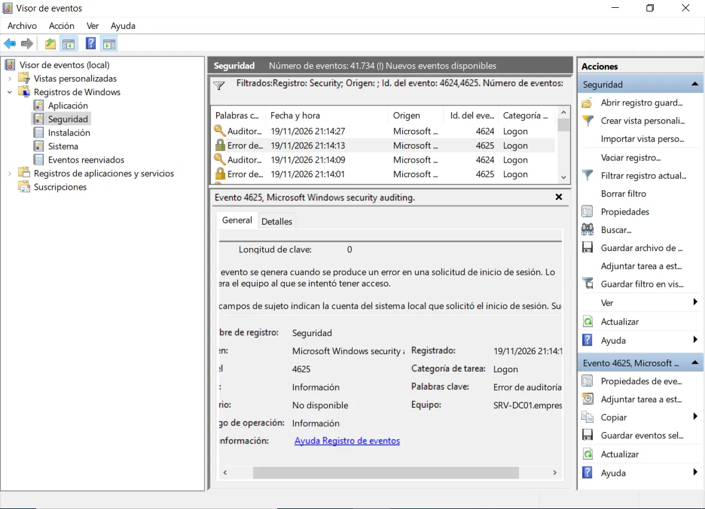
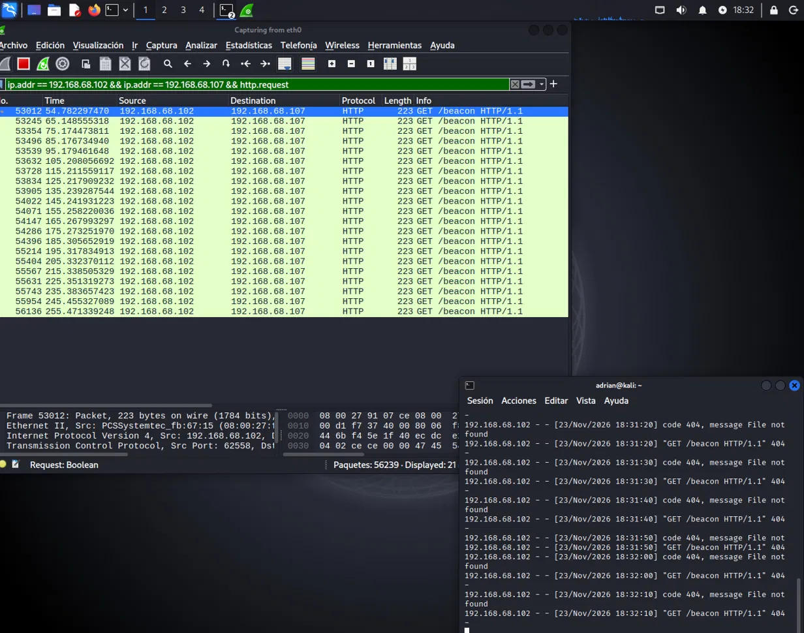
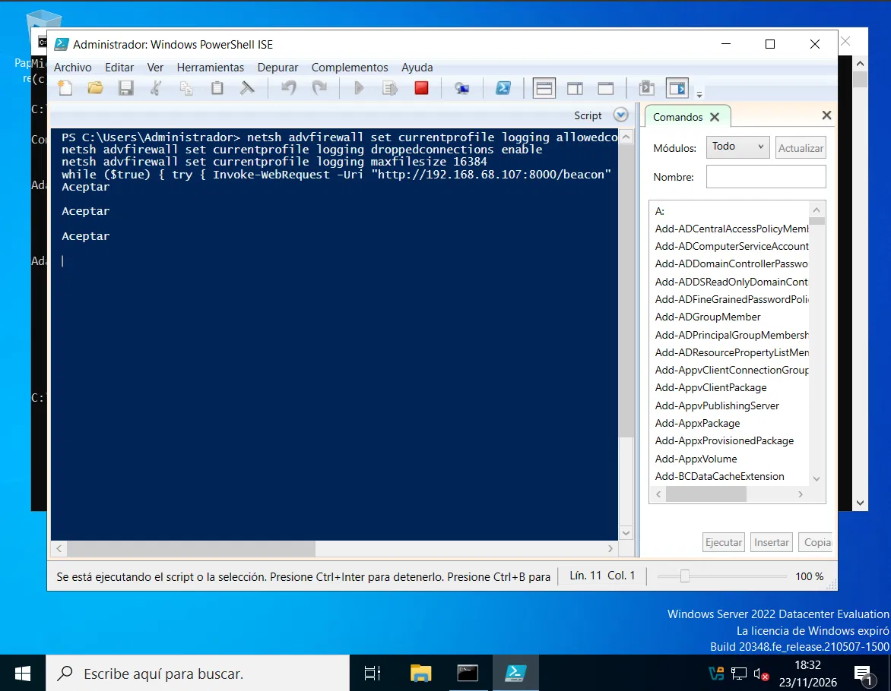
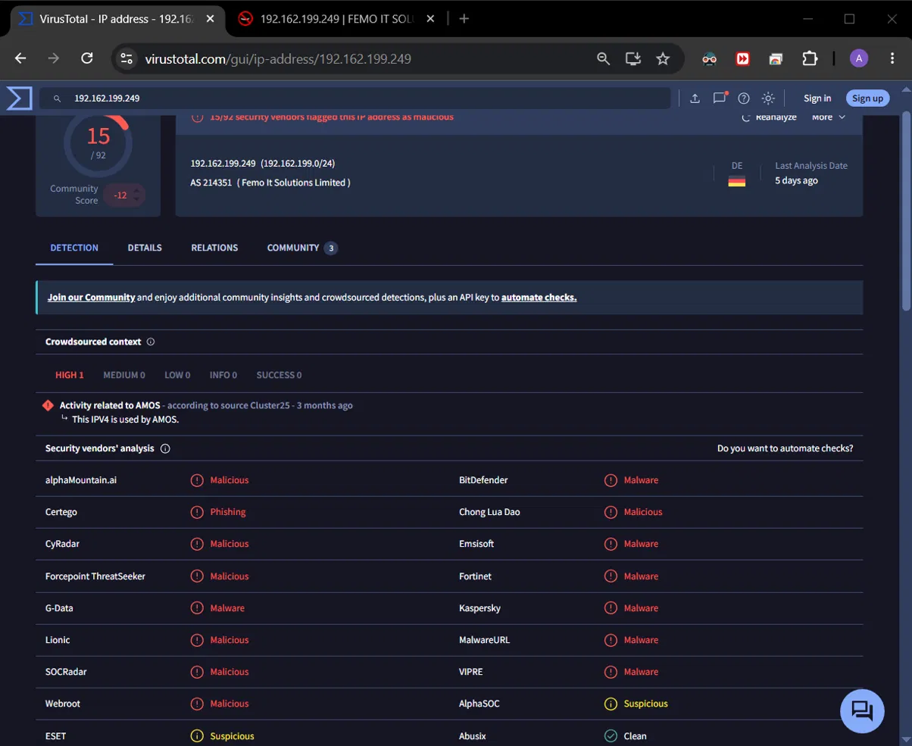
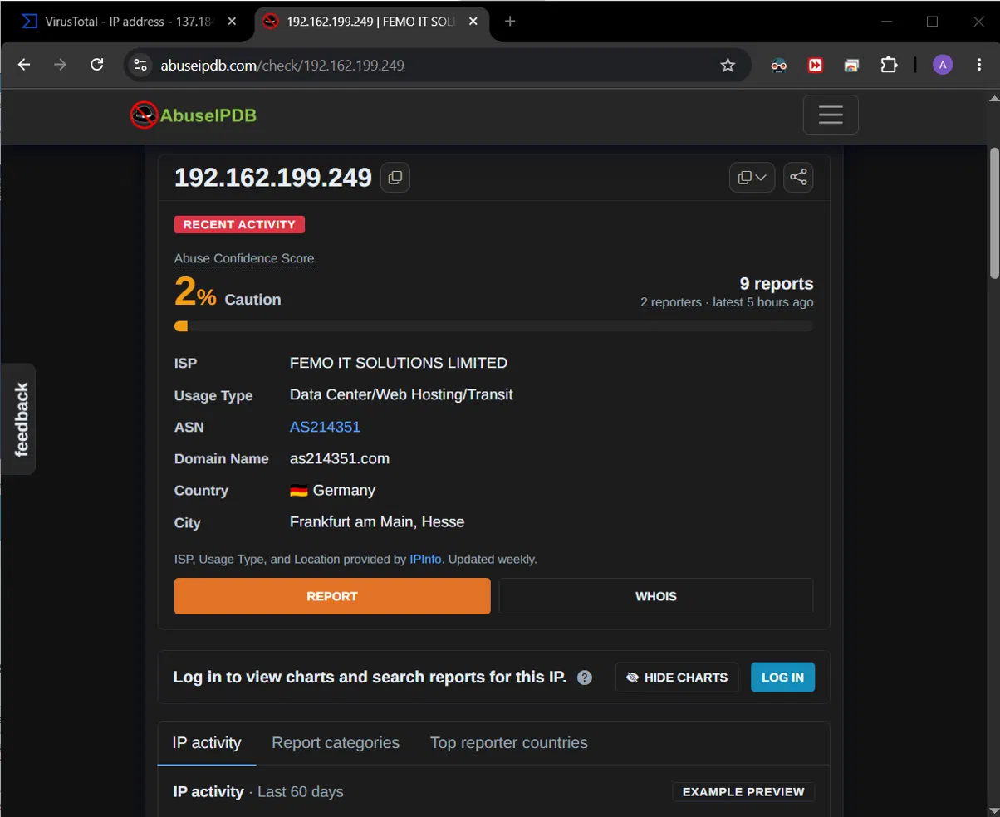
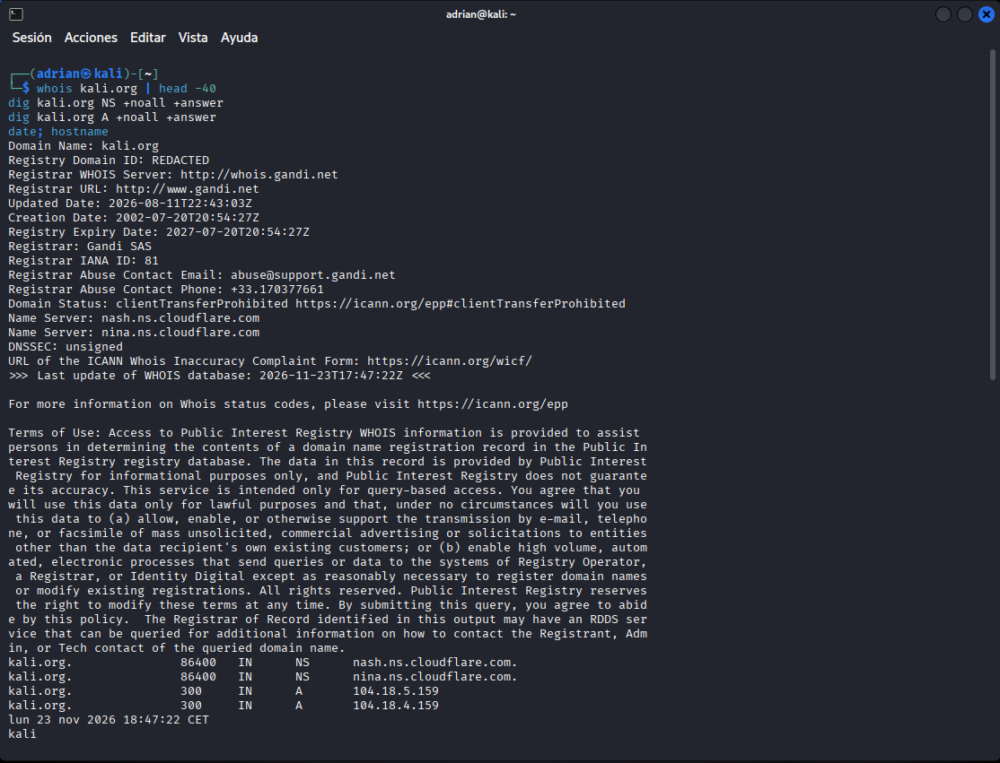

# 2. Detección y auditoría

## 2.1 Clasificación y gravedad del incidente

Siguiendo la taxonomía de la Guía Nacional de Notificación y Gestión de Ciberincidentes y los criterios de NIST SP 800-61:

| **Criterio** | **Valoración** | **Justificación** |
|---|---|---|
| Tipo de incidente | Código dañino (malware) con origen en phishing; posible compromiso de la información (exfiltración) | Correo fraudulento con adjunto malicioso ejecutado por un empleado; conexiones salientes anómalas. |
| Vector de ataque | Correo electrónico (adjunto con macro) | MITRE ATT&CK T1566.001 (Spearphishing Attachment) y T1204.002 (User Execution: Malicious File). |
| Peligrosidad | MUY ALTA | El código se ejecutó, hay comunicación con infraestructura externa (posible C2) y movimiento hacia recursos compartidos. |
| Impacto | ALTO (puede pasar a CRÍTICO) | Posible fuga de datos personales de clientes; afecta a confidencialidad. Sube a crítico si se confirma la extracción. |
| Prioridad | P1 - Atención inmediata | Obligaciones legales (RGPD), riesgo reputacional y atacante potencialmente activo. |
| Estado | Abierto, en contención | INC-2026-001. Se revisará la clasificación a medida que haya evidencias. |

**Gravedad global provisional: ALTA / CRÍTICA**. Se adopta el principio de precaución: hasta que se demuestre lo contrario, se asume que hay exfiltración y que el atacante mantiene acceso.

## 2.2 Sistemas y servicios potencialmente afectados

| **Sistema / servicio** | **Motivo de sospecha** | **Prioridad de revisión** |
|---|---|---|
| WS-ADM-07 (equipo del empleado) | Origen de la ejecución y de las conexiones externas | Inmediata |
| Cuenta de usuario del empleado | Credenciales y tokens en memoria o navegador pueden haberse robado | Inmediata |
| Servidor de ficheros SRV-FICHEROS (carpeta Clientes) | Intentos de acceso detectados | Inmediata |
| Servidor de correo / pasarela antispam | Otros 13 destinatarios del correo; posible reenvío interno | Alta |
| Los otros 13 equipos y usuarios que recibieron el correo | Pueden haber abierto el adjunto sin avisar | Alta |
| Controlador de dominio / Active Directory | Posible enumeración, abuso de cuentas privilegiadas | Alta |
| Base de datos / CRM de clientes | Almacén de datos personales objetivo del atacante | Alta |
| Firewall, proxy y DNS | Origen de los registros de conexiones salientes | Media (fuente de evidencia) |
| Copias de seguridad | Si son accesibles desde la red, podrían verse comprometidas | Media |
| VPN, aplicaciones en la nube y correo de la nube | Posible reutilización de credenciales robadas | Media |

## 2.3 Herramientas de detección y monitorización

| **Categoría** | **Herramientas** | **Para qué se usan en este incidente** |
|---|---|---|
| Antivirus / EDR | Microsoft Defender for Endpoint, CrowdStrike, SentinelOne; en laboratorio, Microsoft Defender | Alertas, aislamiento remoto del equipo, árbol de procesos, búsqueda de IOC en toda la flota. |
| SIEM / análisis de logs | Wazuh, Elastic Security, Splunk, Microsoft Sentinel | Centralizar logs y correlacionar: correo, endpoint, firewall y AD. |
| Telemetría de sistema | Sysmon (Sysinternals) con configuración SwiftOnSecurity, Visor de eventos | Creación de procesos, conexiones de red, DNS, ficheros creados. |
| Red e IDS/IPS | Wireshark, tcpdump, Zeek, Suricata, Security Onion, NetFlow del firewall | Detectar beaconing, volúmenes anómalos y destinos raros. |
| Correo | Logs de la pasarela, MXToolbox, cabeceras | Cuántos correos, quién los abrió, quién hizo clic. |
| Hunting y recogida | Velociraptor, KAPE, Autoruns, Process Explorer, TCPView | Buscar persistencia y recolectar artefactos. |
| Inteligencia (OSINT/TI) | VirusTotal, AbuseIPDB, urlscan.io, Shodan, MISP, AlienVault OTX, whois | Reputación y contexto de IP, dominios y hashes. |

## 2.4 Registros que se consultarían

### Antivirus / EDR

Consola central de alertas: nombre de la detección, ruta del fichero, usuario, acción tomada (bloqueado, en cuarentena, permitido). En Windows, el registro *Microsoft-Windows-Windows Defender/Operational* con los eventos **1116** (malware detectado) y **1117** (acción realizada). Interesa saber si hubo ejecución antes de la alerta.

### Firewall y proxy

Conexiones salientes desde WS-ADM-07: destino, puerto, bytes enviados y recibidos, frecuencia. Busco conexiones periódicas (beaconing), destinos nunca antes vistos, puertos inusuales y subidas de datos grandes (indicador de exfiltración). Además, trazas de los DNS: consultas al dominio cdn-update-delta.example.

### Sistema operativo (Windows y servidor de ficheros)

| **Registro / ID** | **Qué indica** |
|---|---|
| Security 4624 / 4625 | Inicios de sesión correctos / fallidos; el tipo 3 indica acceso por red (movimiento lateral). |
| Security 4688 | Creación de procesos (con línea de comandos si está habilitado): WINWORD lanzando PowerShell o cmd es muy sospechoso. |
| Security 5140 / 5145 | Acceso a recursos compartidos de red (qué carpetas y qué usuario). |
| Security 4672 / 4768 / 4769 | Privilegios asignados y tickets Kerberos: abuso de cuentas privilegiadas. |
| Security 1102 / System 104 | Borrado de registros de auditoría (el atacante borra sus huellas). |
| System 7045 / Security 4698 | Instalación de servicios y creación de tareas programadas (persistencia). |
| Sysmon 1 / 3 / 11 / 22 | Proceso creado / conexión de red / fichero creado / consulta DNS. |
| PowerShell 4104 | Contenido de scripts ejecutados (Script Block Logging). |

### Tráfico de red

Captura y análisis con Wireshark/tcpdump o NetFlow: conversaciones (Statistics &gt; Conversations), consultas DNS, campo SNI de TLS (tls.handshake.extensions_server_name), periodicidad de las conexiones y volumen enviado. Filtros útiles: ip.addr == 203.0.113.45, dns, http.request.

### Práctica de laboratorio A: simular la comunicación sospechosa

Para tener registros reales que analizar, simulé en el laboratorio un malware que contacta de forma periódica con un servidor externo (beaconing). VM-KALI hizo de servidor del atacante (en el caso, 203.0.113.45) y VM-WIN de equipo infectado.

**En VM-KALI** preparé el servidor web de pruebas y la captura de tráfico (interfaz eth0):

```bash
mkdir ~/servidor && cd ~/servidor
sudo tcpdump -i eth0 host 192.168.68.102 -w ~/beacon.pcap &    # captura en segundo plano
python3 -m http.server 8000
```

**En VM-WIN**, en PowerShell como administrador, activé el registro del firewall y lancé el bucle de beaconing:

```powershell
netsh advfirewall set currentprofile logging allowedconnections enable
netsh advfirewall set currentprofile logging droppedconnections enable
netsh advfirewall set currentprofile logging maxfilesize 16384
# Simulación de beaconing: una petición cada 10 segundos (lo dejé en marcha varios minutos)
while ($true) { try { Invoke-WebRequest -Uri "http://192.168.68.107:8000/beacon" -UseBasicParsing | Out-Null } catch {}; Start-Sleep -Seconds 10 }
```

> **Qué simulé**
>
> Esto no es malware: son peticiones HTTP inocuas a mi propia máquina Kali. Sirve para generar el mismo patrón que un implante real (conexión saliente periódica a una IP externa) y poder detectarlo con las herramientas del apartado.

### Práctica B: detección por antivirus con el fichero de prueba EICAR

EICAR es una cadena estándar inofensiva que todos los antivirus detectan como si fuera malware. En VM-WIN, desde PowerShell, creé el fichero de prueba:

```powershell
Set-Content -Path $env:USERPROFILE\Desktop\eicar.txt -Value 'X5O!P%@AP[4\PZX54(P^)7CC)7}$EICAR-STANDARD-ANTIVIRUS-TEST-FILE!$H+H*'
```

Defender lo detectó y lo puso en cuarentena casi de inmediato (19/11/2026, 21:00). Quedó registrado en el historial de protección (captura 2.1) y en el Visor de eventos con los ID 1116 y 1117 (captura 2.2). Después consulté el registro del firewall (captura 2.3), los inicios de sesión fallidos y correctos, para los que intenté entrar con un usuario inexistente (captura 2.4), y el tráfico del beaconing en ambos extremos (captura 2.5). Los comandos de las capturas 2.3 y 2.4 fueron:

```powershell
Select-String 192.168.68.107 C:\Windows\System32\LogFiles\Firewall\pfirewall.log | Select-Object -Last 12
Get-WinEvent -FilterHashtable @{LogName='Security';Id=4625} -MaxEvents 2 | Format-List TimeCreated,Id,Message
```



**Captura 2.1.** *Protección contra virus y amenazas de Microsoft Defender en VM-WIN: amenaza «Virus:DOS/EICAR_Test_File» en cuarentena (19/11/2026 21:00), gravedad grave, elemento afectado C:\\Users\\Administrador\\Desktop\\eicar.txt.*



**Captura 2.2.** *Visor de eventos de VM-WIN, registro Microsoft-Windows-Windows Defender/Operational: evento 1116 (malware detectado, 21:00:36) y evento 1117 (acción realizada, 21:00:51). El detalle del 1116 indica Virus:DOS/EICAR_Test_File y el equipo SRV-DC01.*



**Captura 2.3.** *Registro del firewall de Windows (pfirewall.log) filtrado por la IP de VM-KALI: conexiones TCP permitidas (ALLOW) de 192.168.68.102 a 192.168.68.107, puerto 8000, cada 10 segundos aproximadamente (19/11/2026 21:10 a 21:12). Es el patrón periódico del beaconing.*



**Captura 2.4 (a).** *Evento de seguridad 4625 (error de inicio de sesión) obtenido con Get-WinEvent en VM-WIN (19/11/2026 21:14:29): cuenta «usuarioinexistente» del dominio EMPRESA, estado 0xC000006D y subestado 0xC0000064 (usuario desconocido).*



**Captura 2.4 (b).** *Visor de eventos, registro de Seguridad filtrado por los ID 4624 (inicio correcto) y 4625 (inicio fallido), con eventos de ambos tipos sobre las 21:14 del 19/11/2026 y el detalle de un 4625.*



**Captura 2.5 (a).** *VM-KALI durante la simulación (23/11/2026, \~18:31): Wireshark captura en eth0 y, con el filtro ip.addr == 192.168.68.102 && ip.addr == 192.168.68.107 && http.request, muestra las peticiones GET /beacon cada 10 segundos. En la terminal, el servidor http.server registra las mismas peticiones (respuesta 404 porque el fichero no existe).*



**Captura 2.5 (b).** *VM-WIN en el mismo momento (23/11/2026 18:32): PowerShell ISE con los comandos netsh que activan el registro del firewall y el bucle que lanza Invoke-WebRequest a http://192.168.68.107:8000/beacon.*

## 2.5 Investigación OSINT de IP y dominios sospechosos

OSINT (inteligencia de fuentes abiertas) permite entender el origen y la reputación de un indicador sin tocar la infraestructura del atacante. **Regla: consultar, nunca conectarse** a la IP o el dominio sospechosos desde la red de la empresa.

| **Indicador (caso)** | **Fuentes y técnicas** | **Qué se busca** |
|---|---|---|
| IP 203.0.113.45 | VirusTotal, AbuseIPDB, Shodan/Censys, ipinfo.io, whois (RIR), AlienVault OTX | País, proveedor (ASN), reputación, informes de abuso, puertos y servicios expuestos, relación con otros dominios. |
| Dominio cdn-update-delta.example | whois, dig/nslookup, VirusTotal, urlscan.io, crt.sh (certificados), SecurityTrails | Fecha de registro (dominios recién creados son sospechosos), registrante, servidores DNS, IP asociadas, certificados emitidos. |
| Dominio rrhh-solucionesdelta.example (typosquatting) | whois, MXToolbox (SPF/DMARC), comparación con el dominio legítimo | Parecido visual con el nombre de la empresa, antigüedad, configuración de correo. |
| Hash del adjunto | VirusTotal, MalwareBazaar, Hybrid Analysis | Si el fichero es conocido y qué familia de malware es. |

> **Parte práctica con datos reales**
>
> Las IP y dominios del caso son ficticios y no devuelven información útil. Para demostrar la técnica utilicé un indicador real ya publicado como malicioso, la IP 192.162.199.249, y lo consulté solo en las webs de OSINT (VirusTotal y AbuseIPDB), sin abrirlo ni conectarme a él. En el informe lo trato como «indicador de ejemplo real utilizado para demostrar la técnica, equivalente a 203.0.113.45 del caso».



**Captura 2.6.** *VirusTotal, indicador real de ejemplo 192.162.199.249: 15 de 92 motores lo marcan como malicioso; pertenece al AS214351 (Femo IT Solutions Limited), en Alemania, y se relaciona con actividad del stealer AMOS.*



**Captura 2.7.** *AbuseIPDB, misma IP: confianza de abuso del 2 %, 9 informes, ISP FEMO IT SOLUTIONS LIMITED, tipo de uso Data Center/Web Hosting/Transit, AS214351, Frankfurt am Main (Alemania).*



**Captura 2.8.** *whois y dig en VM-KALI sobre un dominio real y legítimo (kali.org), 23/11/2026 18:47:22: registrador Gandi SAS, creado el 2002-07-20, servidores DNS de Cloudflare y dos registros A. Se usa kali.org porque los dominios del caso (.example) no existen y whois no admite el TLD .es.*

## 2.6 Ficha de registro del incidente

| **Campo** | **Valor** |
|---|---|
| **ID de incidente** | INC-2026-001 |
| **Fecha y hora de detección** | 16/11/2026, 10:50 (alerta de antivirus). Escalado a ciberseguridad a las 11:40. |
| **Detectado por** | Departamento de informática (alerta de antivirus y revisión de firewall) |
| **Responsable del incidente** | Responsable de ciberseguridad (Adrián Fuente) |
| **Tipo / categoría** | Código dañino con origen en phishing; posible fuga de información |
| **Gravedad / prioridad** | Alta, potencialmente crítica / P1 |
| **Estado** | Abierto - en contención |
| **Vector de entrada** | Correo electrónico con adjunto Nomina_Noviembre_2026.docm (macro) |
| **Activos afectados (confirmados)** | WS-ADM-07; cuenta del usuario afectado |
| **Activos en revisión** | SRV-FICHEROS, 13 equipos receptores del correo, AD, CRM, correo, copias de seguridad |
| **Datos potencialmente afectados** | Datos personales de clientes (identificación, contacto y, posiblemente, facturación) |
| **Indicadores de compromiso (IOC)** | IP 203.0.113.45 y 198.51.100.23; dominios cdn-update-delta.example y rrhh-solucionesdelta.example; remitente real noreply@mailer-xyz.example (Reply-To rrhh.nominas@rrhh-solucionesdelta.example); SHA-256 del adjunto: en el laboratorio se usó la muestra EICAR como equivalente, 275a021bbfb6489e54d471899f7db9d1663fc695ec2fe2a2c4538aabf651fd0f (apartado 3.4) |
| **Técnicas ATT&CK** | T1566.001, T1204.002, T1071 (protocolo de aplicación para C2), T1083 (descubrimiento de ficheros), T1021.002 (SMB), T1041 (exfiltración por canal C2, por confirmar) |
| **Acciones realizadas** | Apertura de incidente, preservación de logs, aislamiento de WS-ADM-07, bloqueo de IOC en firewall y DNS, aviso a dirección y al DPO |
| **Notificaciones** | Dirección y DPO (internas). AEPD: pendiente de valoración (plazo máximo 72 h desde el conocimiento). |
| **Próximos pasos** | Análisis forense, revisión de las carpetas accedidas, restablecimiento de credenciales, decisión sobre notificación y recuperación |
| **Lecciones aprendidas** | Se completa al cierre (apartado 4.3 y conclusiones) |
