# 3. Investigación y análisis

## 3.1 Evidencias que es necesario recopilar

Se recopilan siguiendo el **orden de volatilidad** (RFC 3227), de más a menos volátil, porque lo que está en memoria desaparece al apagar el equipo:

| **Orden** | **Evidencia** | **Fuente / método** |
|---|---|---|
| 1 | Memoria RAM (procesos, conexiones, claves, malware residente) | Volcado con FTK Imager, WinPmem o DumpIt del equipo encendido |
| 2 | Estado de red y procesos en ejecución | netstat, Get-NetTCPConnection, tasklist, TCPView, tabla ARP/DNS cache |
| 3 | Sesiones y usuarios conectados | query user, net session, logs de AD |
| 4 | Disco del equipo afectado (imagen forense) | Imagen bit a bit con FTK Imager o dd, con bloqueo de escritura |
| 5 | Logs de sistema: Windows, Sysmon, PowerShell, Defender | Exportar .evtx |
| 6 | Logs de red: firewall, proxy, DNS, NetFlow, pcap | Exportar desde dispositivos y SIEM |
| 7 | Correo original y logs de la pasarela | Fichero .eml con cabeceras completas, trazas de entrega y clics |
| 8 | Archivo malicioso (adjunto y payload descargado) | Copia con hash, nunca ejecutar fuera del laboratorio |
| 9 | Logs del servidor de ficheros y AD | Eventos 5140/5145, 4624, 4768/4769 |
| 10 | Copias de seguridad y documentación | Estado de backups, inventario, políticas |

## 3.2 Preservación de la integridad de las evidencias

- **No trabajar sobre el original:** se hace una imagen forense y se analiza siempre la copia.
- **Bloqueo de escritura** (write-blocker hardware o software) al adquirir discos.
- **Hash SHA-256 antes y después** de cada copia; deben coincidir. Se registra en el acta.
- **Documentar todo:** quién, cuándo, cómo, con qué herramienta y versión, hora sincronizada (NTP) y zona horaria.
- **Almacenamiento seguro:** originales en bolsa o caja precintada y etiquetada; copias en un repositorio de solo lectura, con acceso restringido y cifrado.
- **No apagar** el equipo antes de volcar la memoria. Si hay que aislar, desconectar de la red; no reiniciar.
- **Registrar las acciones del analista:** cada comando ejecutado sobre un equipo vivo modifica el sistema; se anota.
- **Separar roles:** quien recoge la evidencia no es quien la analiza, cuando es posible.

## 3.3 Investigación del correo electrónico

Se solicita al usuario que **no borre** el correo y se reenvía a seguridad **como adjunto (.eml)** para conservar las cabeceras. Se analizan los siguientes elementos:

| **Elemento** | **Qué comprobar** | **Hallazgo en el caso (correo de ejemplo del Anexo A)** |
|---|---|---|
| From vs. Return-Path / Reply-To | Coincidencia entre dominios | From aparenta rrhh@solucionesdelta.example, pero Return-Path y Reply-To van a otros dominios. |
| Cadena Received (de abajo a arriba) | Primer servidor que entregó el mensaje, IP de origen | Origen en 203.0.113.45, ajeno a la infraestructura de la empresa. |
| Authentication-Results | SPF, DKIM, DMARC | spf=fail, dkim=none, dmarc=fail: suplantación del dominio. |
| Asunto, cuerpo, tono | Urgencia, saludo genérico, faltas | Asunto de urgencia y mensaje sin personalizar. |
| Adjunto | Extensión, nombre, hash | Documento .docm que pide habilitar macros. |
| Enlaces | URL reales frente al texto mostrado | Dominio rrhh-solucionesdelta.example (typosquatting). |

En la práctica trabajé con el correo de ejemplo del Anexo A (phishing_sample.eml) y no analicé ningún adjunto real. Con la línea de comandos extraje las cabeceras relevantes y comprobé que From y Reply-To/Return-Path apuntan a dominios distintos y que SPF y DMARC fallan (captura 3.1). Después pegué las cabeceras en MXToolbox Email Header Analyzer, que confirmó los fallos de SPF, DKIM y DMARC y un único salto desde 203.0.113.45 (captura 3.2). Comandos de la captura 3.1:

```bash
grep -Ei '^(from|reply-to|return-path|subject|x-originating-ip):' phishing_sample.eml
grep -Ei -A2 '^(received|authentication-results):' phishing_sample.eml
date; hostname
```

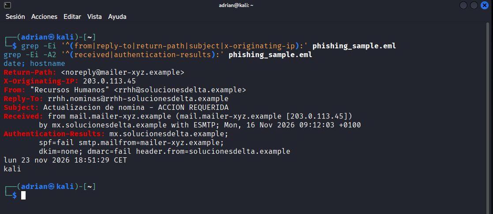

**Captura 3.1.** *Análisis de las cabeceras del correo de ejemplo con grep en VM-KALI (23/11/2026 18:51:29): el From aparenta ser rrhh@solucionesdelta.example, pero Return-Path y Reply-To apuntan a otros dominios; X-Originating-IP y Received señalan 203.0.113.45; Authentication-Results muestra spf=fail, dkim=none y dmarc=fail.*

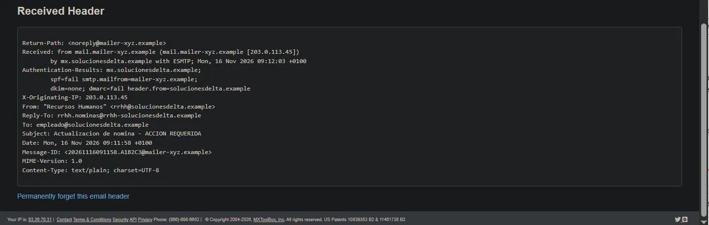

**Captura 3.2 (a).** *MXToolbox Email Header Analyzer: cabeceras del correo de ejemplo pegadas en el analizador.*

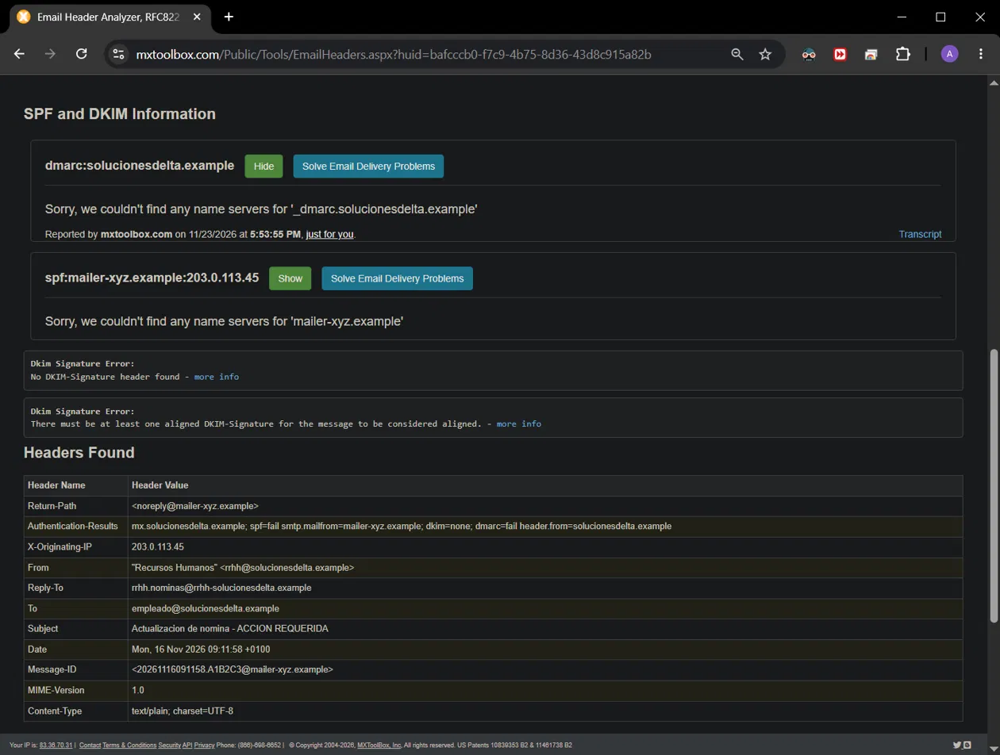

**Captura 3.2 (b).** *MXToolbox, información SPF y DKIM: no se encuentran servidores de nombres para el dominio ficticio y no hay firma DKIM. Debajo, la tabla de cabeceras encontradas (Return-Path, Authentication-Results, X-Originating-IP, From, Reply-To, etc.).*

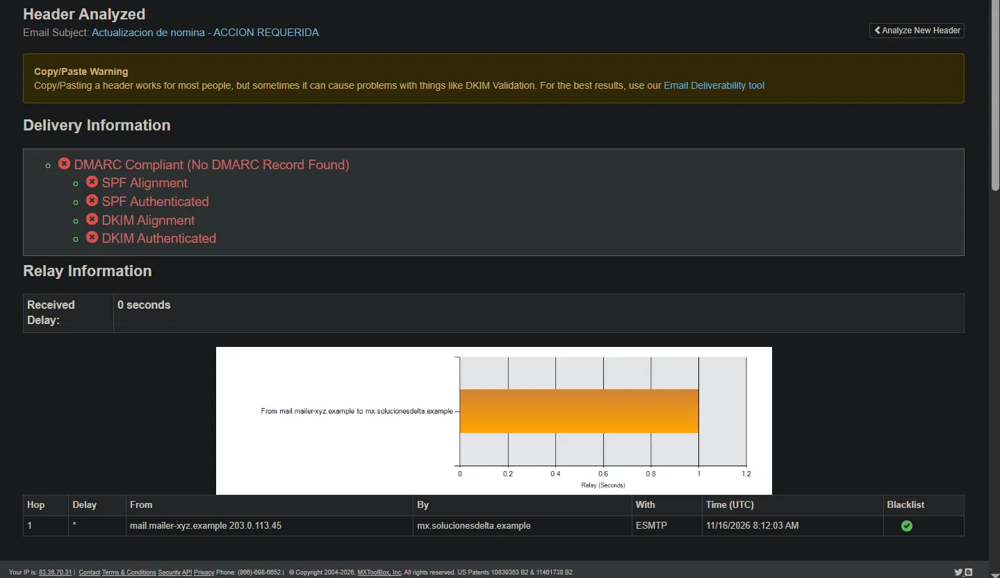

**Captura 3.2 (c).** *MXToolbox, resultado del análisis: DMARC no conforme y alineación SPF y DKIM fallidas, con un único salto desde mail.mailer-xyz.example (203.0.113.45) hasta mx.solucionesdelta.example.*

## 3.4 Investigación del archivo malicioso

El análisis se hace en dos fases, siempre en el entorno aislado: **análisis estático** (sin ejecutar el fichero) y, si hace falta, **análisis dinámico** en un sandbox (Any.Run, Hybrid Analysis, Cuckoo) con la red controlada. Para un documento ofimático con macros, el procedimiento estático es:

- Identificar el tipo real del fichero (file), no fiarse de la extensión.
- Calcular el hash SHA-256 y consultarlo en VirusTotal (la búsqueda por hash no sube el fichero).
- Extraer metadatos (exiftool): autor, fechas, software.
- Extraer cadenas legibles (strings) y URL/IP incrustadas.
- Analizar las macros con olevba (oletools): autoejecución (AutoOpen), llamadas a shell o PowerShell, descargas.
- Documentar los IOC obtenidos (URL, IP, hash, nombres de fichero, claves de registro).

**Preparación.** No disponía de Word ni de LibreOffice en el laboratorio, así que no pude crear un documento .docm con macro. Como alternativa inofensiva analicé el fichero de prueba EICAR, guardado como texto en eicar.com.txt. El procedimiento es el mismo; con un documento con macros reales olevba listaría las macros (por ejemplo, AutoOpen) y los indicadores sospechosos.

**En VM-KALI** creé la muestra y ejecuté el análisis estático:

```bash
mkdir -p muestras && cd muestras
echo -n 'X5O!P%@AP[4\PZX54(P^)7CC)7}$EICAR-STANDARD-ANTIVIRUS-TEST-FILE!$H+H*' > eicar.com.txt
file eicar.com.txt
sha256sum eicar.com.txt
exiftool eicar.com.txt | head -20
olevba eicar.com.txt
date; hostname
```

**Resultado.** file identifica la muestra como «EICAR virus test files» y su SHA-256 es 275a021bbfb6489e54d471899f7db9d1663fc695ec2fe2a2c4538aabf651fd0f (captura 3.3). olevba la trata como texto y no encuentra macros ni indicadores sospechosos (captura 3.4), lo cual es correcto: EICAR no es un documento ofimático. La búsqueda del hash en VirusTotal la identifica como EICAR en 64 de 66 motores (captura 3.5) sin subir el fichero.

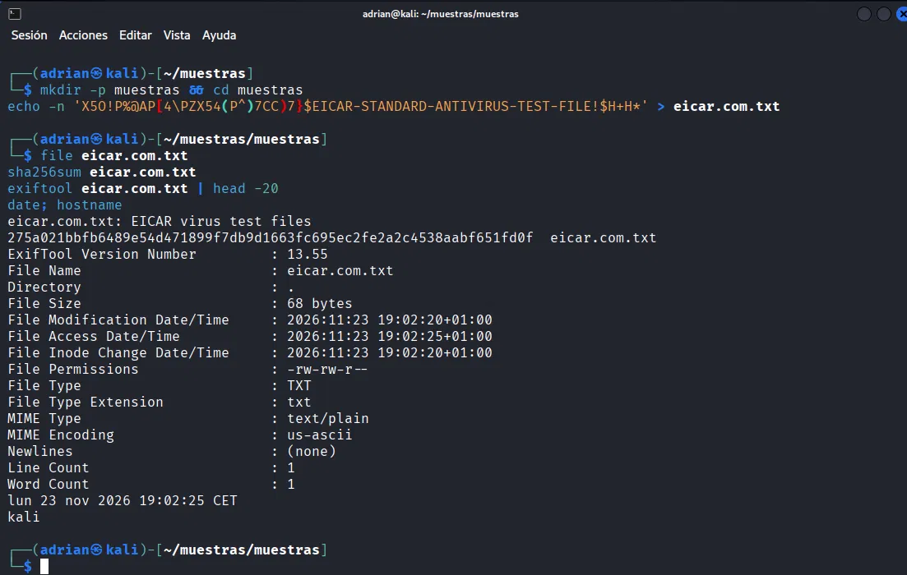

**Captura 3.3.** *Análisis estático de la muestra EICAR en VM-KALI (23/11/2026 19:02:25): file la identifica como «EICAR virus test files», su SHA-256 es 275a021b…651fd0f y exiftool muestra 68 bytes, tipo TXT y MIME text/plain.*

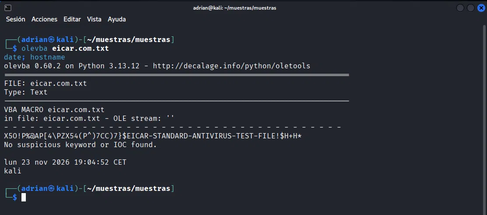

**Captura 3.4.** *olevba sobre eicar.com.txt en VM-KALI (23/11/2026 19:04:52): detecta el tipo «Text» y concluye «No suspicious keyword or IOC found», porque la muestra no es un documento con macros.*

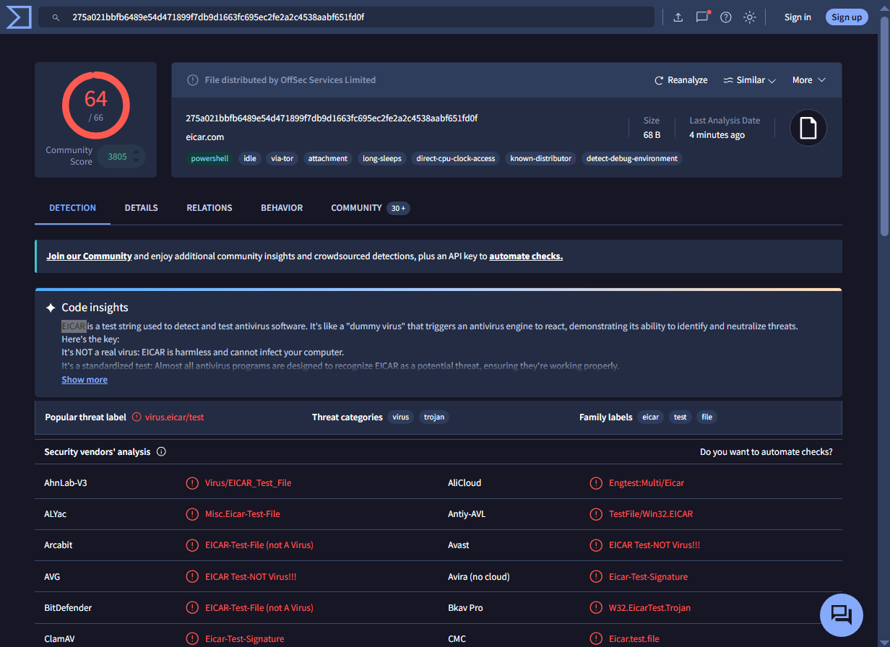

**Captura 3.5.** *Búsqueda del hash SHA-256 de la muestra en VirusTotal: 64 de 66 motores la detectan como EICAR (virus.eicar/test). La búsqueda por hash no sube el fichero.*

## 3.5 Análisis de las conexiones sospechosas

Se busca responder a cinco preguntas: ¿qué proceso hizo la conexión?, ¿a dónde?, ¿cuándo y con qué frecuencia?, ¿cuántos datos se movieron? y ¿qué otros equipos hablan con el mismo destino? En el equipo vivo se usan netstat o TCPView para relacionar la conexión con un proceso (PID), y en el tráfico capturado, Wireshark para ver la periodicidad.

**En VM-WIN**, con el beaconing en marcha, relacioné la conexión con su proceso. Como las peticiones HTTP del bucle duran muy poco y Get-NetTCPConnection no llegaba a verlas, abrí una conexión TCP mantenida con TcpClient hacia 192.168.68.107:8000 para poder consultarla:

```powershell
$c = New-Object Net.Sockets.TcpClient('192.168.68.107',8000)
netstat -ano | findstr 192.168.68.107
tasklist /fi "PID eq 4824"
Get-Date -DisplayHint Date; Get-Date -DisplayHint Time
```

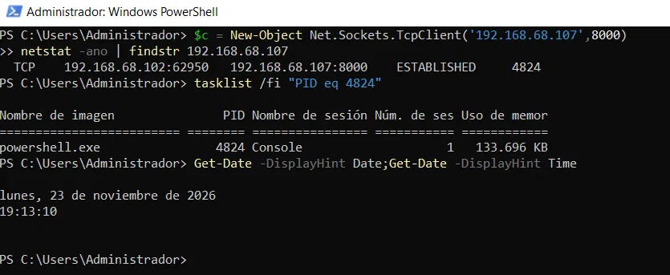

**Captura 3.6.** *Relación conexión-proceso en VM-WIN (23/11/2026 19:13:10): netstat muestra la conexión ESTABLISHED de 192.168.68.102:62950 a 192.168.68.107:8000 con PID 4824, y tasklist confirma que ese PID es powershell.exe.*

**En VM-KALI** abrí \~/beacon.pcap en Wireshark y analicé:

- Statistics &gt; Conversations &gt; pestaña IPv4: bytes y paquetes entre 192.168.68.102 y 192.168.68.107 (captura 3.7 b).
- Filtro http.request.uri contains "beacon" && http.request y columna «Time since previous displayed frame» (View &gt; Time Display Format): peticiones cada \~10 s (captura 3.7 a).
- Otras vistas útiles que no capturé: Follow &gt; HTTP Stream, para ver la petición completa, y Statistics &gt; I/O Graph, para visualizar el patrón periódico.
- 
- 

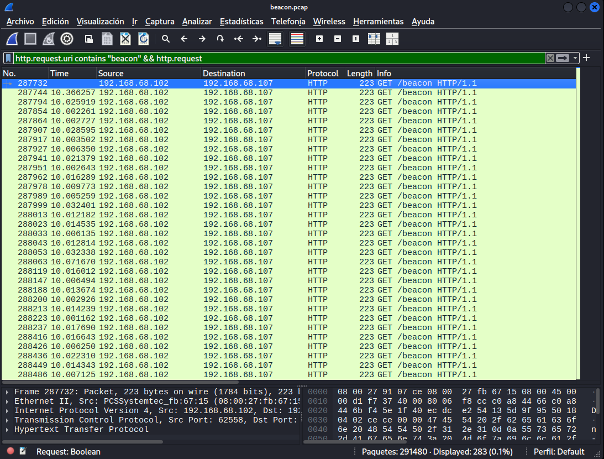

**Captura 3.7 (a).** *Wireshark abriendo beacon.pcap en VM-KALI con el filtro http.request.uri contains "beacon" && http.request: 283 paquetes mostrados de 291 480, con unos 10 segundos entre peticiones consecutivas.*

- 

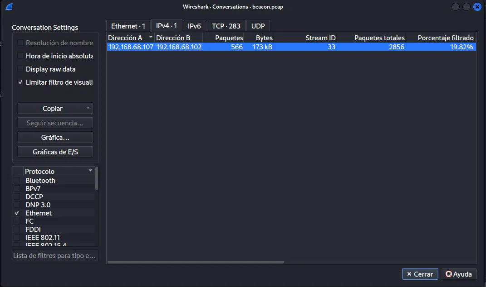

**Captura 3.7 (b).** *Wireshark, Statistics &gt; Conversations &gt; IPv4: una sola conversación entre 192.168.68.107 y 192.168.68.102, con 566 paquetes y 173 kB.*

- 

## 3.6 Cálculo del hash SHA-256 y su utilidad

SHA-256 genera una huella de 256 bits (64 caracteres hexadecimales). Su utilidad en un incidente: (1) **integridad** de las evidencias, (2) **identificación** inequívoca de un fichero malicioso y su búsqueda en bases de datos de amenazas, (3) **cadena de custodia**: demostrar que una evidencia no ha cambiado, (4) detectar duplicados y ficheros alterados, y (5) validez probatoria ante un juzgado o la AEPD.

```bash
# En VM-KALI
echo "Evidencia 001 - informe de prueba" > evidencia.txt
cp evidencia.txt evidencia_original.txt
sha256sum evidencia.txt
echo "." >> evidencia.txt            # cambiar un único carácter
sha256sum evidencia.txt              # el hash cambia por completo (efecto avalancha)
date; hostname
```

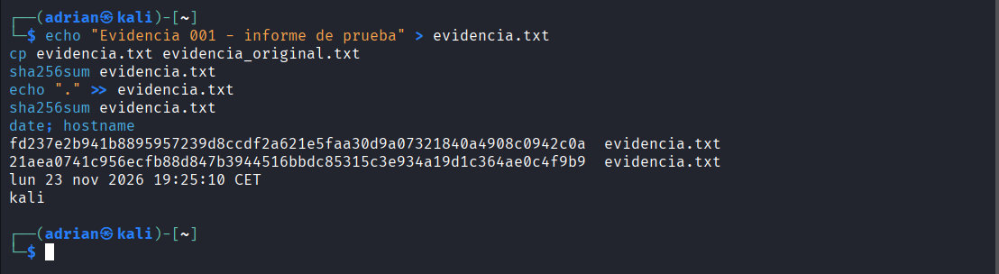

**Captura 3.8.** *SHA-256 en VM-KALI (23/11/2026 19:25:10): el hash de evidencia.txt cambia por completo (fd237e2b…942c0a frente a 21aea074…c4f9b9) tras añadir un solo carácter. Es el efecto avalancha.*

Para demostrar que el hash es independiente del sistema operativo, copié a VM-WIN la **versión original** del fichero (evidencia_original.txt, guardada antes de modificarla) y calculé su hash con PowerShell. El hash coincide con el calculado en Linux para el original, y el del fichero modificado es totalmente distinto:

```powershell
Get-FileHash -Algorithm SHA256 .\evidencia_original.txt
# alternativa clásica: certutil -hashfile evidencia_original.txt SHA256
```

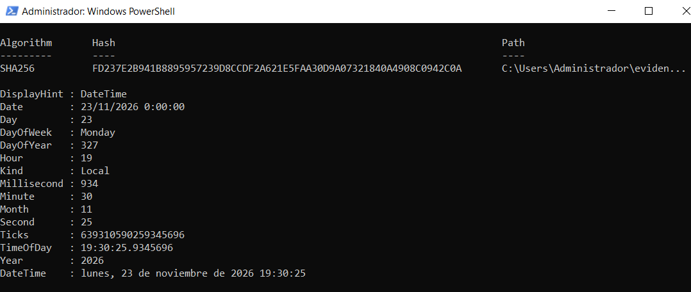

**Captura 3.9.** *Get-FileHash -Algorithm SHA256 en VM-WIN sobre evidencia_original.txt (23/11/2026 19:30:25): el hash FD237E2B…0942C0A coincide con el de la versión original calculada en Linux, por lo que no depende del sistema operativo.*

## 3.7 Preservación forense y cadena de custodia

Para practicar la preservación creé una «imagen forense» de un disco de pruebas pequeño con dd y comprobé su integridad con hash. En un caso real se haría con FTK Imager o dd sobre el disco de WS-ADM-07 con bloqueo de escritura.

```bash
# En VM-KALI: crear un disco de pruebas de 50 MB con un fichero dentro
dd if=/dev/zero of=disco_pruebas.img bs=1M count=50
mkfs.ext4 -q disco_pruebas.img
mkdir -p mnt && sudo mount -o loop disco_pruebas.img mnt
echo "dato del cliente" | sudo tee mnt/cliente.txt && sudo umount mnt
# Adquisición: copia bit a bit + verificación
sha256sum disco_pruebas.img | tee hash_origen.txt
dd if=disco_pruebas.img of=imagen_forense.img bs=4M status=progress
sha256sum imagen_forense.img | tee hash_copia.txt
chmod 444 imagen_forense.img         # solo lectura
```

El SHA-256 del disco de pruebas y el de la imagen forense coinciden (9cd9734ba17a25a882847df99cc473abd2d9d3c197025cc33357ce63d93e762a) y la imagen queda en solo lectura, como en una adquisición real (captura 3.10).

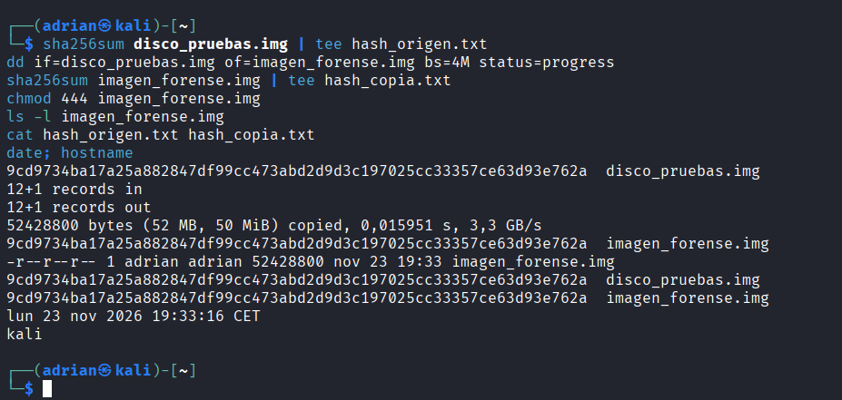

**Captura 3.10.** *Imagen forense con dd en VM-KALI (23/11/2026 19:33:16): el SHA-256 de disco_pruebas.img y el de imagen_forense.img son idénticos (9cd9734b…e762a) y la imagen queda en solo lectura (-r--r--r--, 52 428 800 bytes).*

### Volcado de memoria RAM (no realizado en el laboratorio)

No hice el volcado de memoria RAM (captura opcional 3.11). En un incidente real es la primera evidencia que se recoge por su volatilidad (RFC 3227): con el equipo aislado pero encendido, se ejecutaría FTK Imager (Capture Memory), WinPmem o DumpIt desde un USB de confianza, guardando el volcado en un soporte externo y no en el disco del equipo afectado. Se calcularía su SHA-256 antes de analizarlo con Volatility (procesos, conexiones de red y código inyectado) y cada paso quedaría anotado en la ficha de cadena de custodia.

### Documentación de la cadena de custodia

La cadena de custodia es el registro cronológico e ininterrumpido de quién ha tenido cada evidencia, cuándo, dónde, con qué fin y en qué estado. Se documenta con una ficha por evidencia y una tabla de movimientos. Plantilla rellenada con datos del caso (ficticio):

| **Campo** | **Valor** |
|---|---|
| **ID de evidencia** | EV-001 |
| **Descripción** | Imagen forense del disco SSD 512 GB del equipo WS-ADM-07 (S/N: \[ de serie\]) |
| **Incidente** | INC-2026-001 |
| **Obtenida por / fecha y hora** | Adrián Fuente, 16/11/2026 13:05 (hora de Madrid, equipo sincronizado por NTP) |
| **Lugar de recogida** | Puesto de trabajo de Administración, planta 2 |
| **Método** | FTK Imager con bloqueo de escritura; formato E01 |
| **Hash SHA-256 de origen / de la copia** | SHA-256 del origen y de la copia idénticos (en la práctica con dd: 9cd9734ba17a25a882847df99cc473abd2d9d3c197025cc33357ce63d93e762a, captura 3.10) |
| **Almacenamiento** | Copia de trabajo en repositorio forense cifrado y de solo lectura; original en caja precintada nº 1, armario de seguridad |

| **Fecha y hora** | **Entrega de** | **Recibe** | **Motivo** | **Estado / hash verificado** | **Firmas** |
|---|---|---|---|---|---|
| 16/11 13:05 | Responsable TI | Resp. ciberseguridad | Adquisición de la evidencia | Original intacto; hash calculado | \[firma\] / \[firma\] |
| 16/11 15:30 | Resp. ciberseguridad | Analista forense | Análisis de la copia | Hash verificado: coincide | \[firma\] / \[firma\] |
| 17/11 09:00 | Analista forense | Caja de seguridad | Custodia tras el análisis | Precintada, nº de precinto 0001 | \[firma\] / \[firma\] |
| \[fecha\] | \[nombre\] | \[nombre\] | \[motivo: p. ej., entrega a la autoridad\] | \[estado\] | \[firma\] / \[firma\] |
