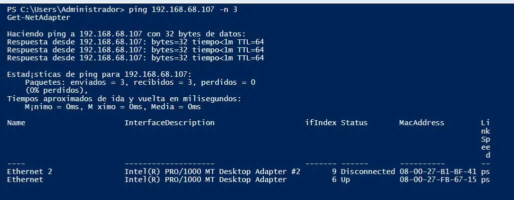
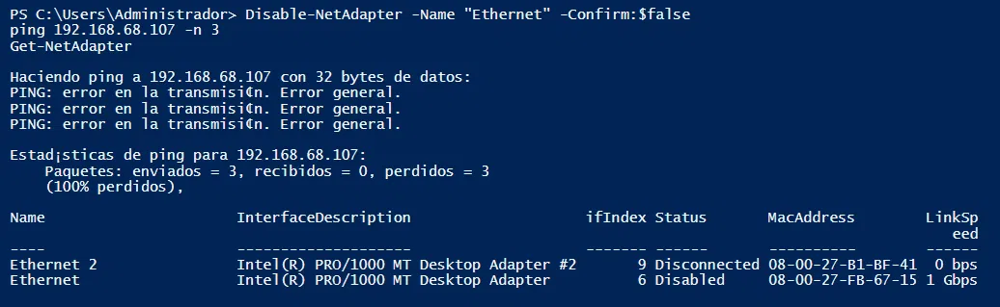
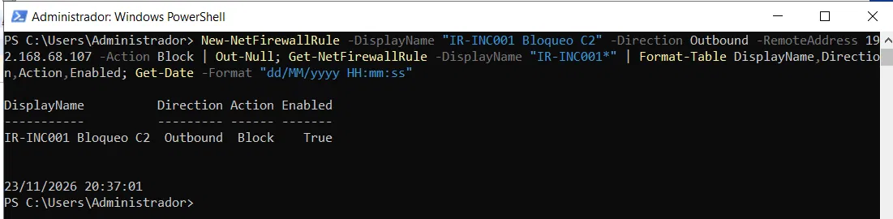
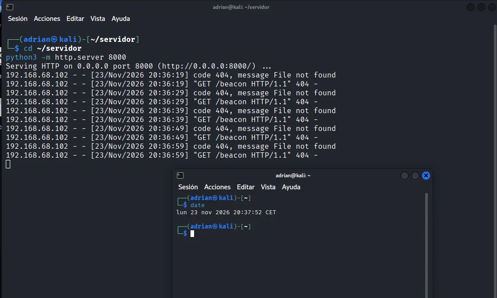
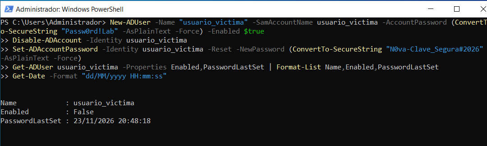
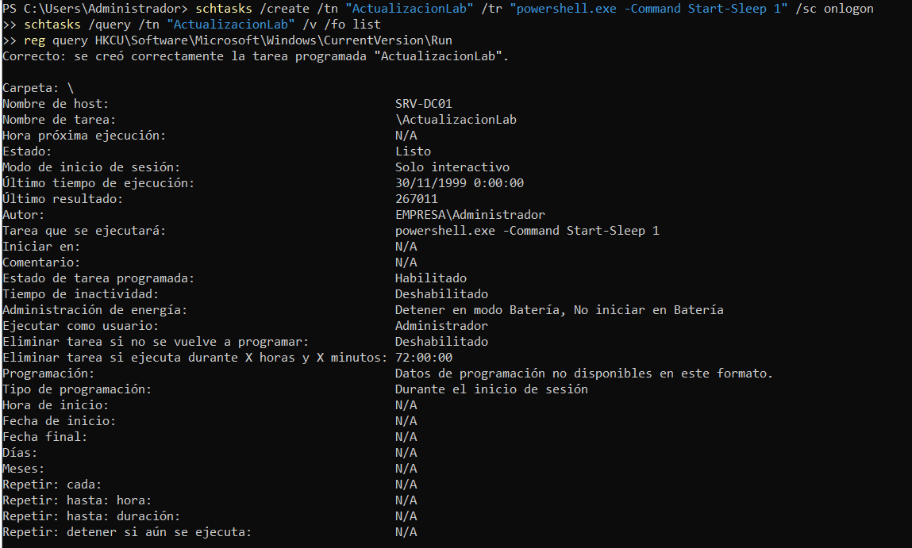
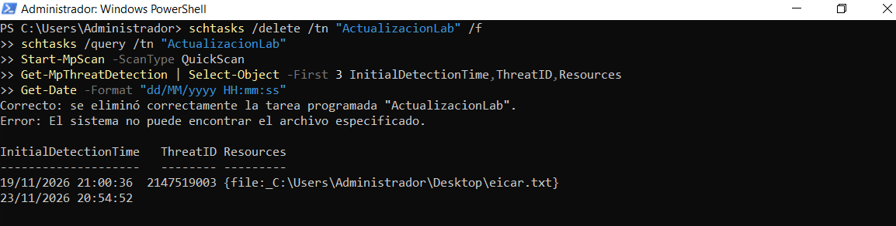
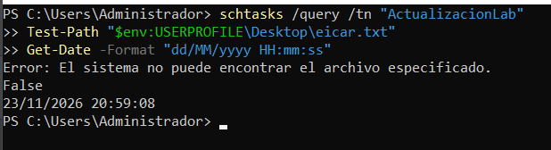
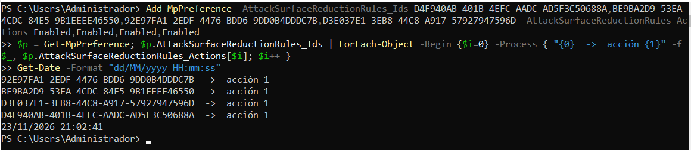

# 4. Respuesta y recuperación

## 4.1 Procedimiento de actuación

Orden de las fases: **contener primero, erradicar después**. Si se elimina el malware antes de entender el alcance, el atacante puede cambiar de táctica y se pierden evidencias. Cada fase tiene responsable, acciones y criterio de finalización.

| **Fase** | **Acciones** | **Responsable** | **Criterio de cierre** |
|---|---|---|---|
| 1. Aislamiento de los equipos afectados | Aislar WS-ADM-07 de la red (aislamiento desde el EDR o desconexión del cable/puerto del switch/VLAN de cuarentena). **No apagar**: se pierde la memoria.<br>Volcar memoria y tomar imagen antes de cualquier limpieza (apartado 3).<br>Identificar a los otros 13 receptores del correo y aislar los que lo abrieron.<br>Segmentar o restringir temporalmente el acceso a SRV-FICHEROS y a los datos de clientes. | Informática + ciberseguridad | Ningún equipo afectado puede comunicarse con la red interna ni con Internet. |
| 2. Bloqueo de conexiones maliciosas | Bloquear en el firewall (entrada y salida) 203.0.113.45 y 198.51.100.23.<br>Bloquear en DNS/proxy cdn-update-delta.example y rrhh-solucionesdelta.example (sinkhole).<br>En la pasarela de correo: bloquear el remitente y dominio; **retirar el correo de todos los buzones** (búsqueda y purga).<br>Bloquear por hash el adjunto en el antivirus/EDR.<br>Vigilar los intentos bloqueados: indican otros equipos infectados. | Redes + ciberseguridad | Reglas aplicadas y verificadas; sin tráfico saliente hacia los IOC. |
| 3. Revocación de credenciales comprometidas | Restablecer contraseña y cerrar sesiones activas del usuario afectado (revocar tokens, cerrar sesiones en la nube).<br>Si el equipo tuvo sesiones de administración o se sospecha de robo de credenciales de dominio: restablecer también las cuentas de servicio y privilegiadas, y **krbtgt dos veces** si hay indicios de compromiso del dominio.<br>Revocar claves API, certificados y VPN asociados.<br>Activar MFA en todas las cuentas.<br>Revisar reglas de reenvío de correo y aplicaciones OAuth creadas por el atacante. | Administración de sistemas + ciberseguridad | Todas las credenciales expuestas renovadas; sin inicios de sesión sospechosos posteriores. |
| 4. Eliminación de la amenaza (erradicación) | Determinar el alcance completo (búsqueda de IOC en toda la flota con el EDR).<br>Buscar persistencia: tareas programadas, claves Run, servicios, WMI, carpetas de inicio, usuarios nuevos.<br>Eliminar el malware. **Preferible reinstalar el equipo desde imagen limpia** en lugar de «limpiar».<br>Parchear la vulnerabilidad o debilidad explotada (macros habilitadas, falta de filtrado, etc.).<br>Ventana de erradicación **coordinada**: se actúa a la vez sobre todos los equipos comprometidos para que el atacante no se reorganice. | Ciberseguridad + informática | Escaneos limpios, sin persistencia ni conexiones a IOC durante 72 h de observación. |
| 5. Recuperación de sistemas y servicios | Restaurar desde copias de seguridad **anteriores** al compromiso y verificadas (hash, antivirus).<br>Reincorporar los servicios por prioridad de negocio (correo, ficheros, CRM) con vigilancia reforzada.<br>Reconectar equipos reinstalados de forma escalonada.<br>Monitorización intensiva 2-4 semanas: alertas ampliadas y revisión diaria de logs. | Informática + ciberseguridad + dirección | Servicios operativos, sin reaparición de IOC, usuarios confirman funcionamiento. |
| 6. Medidas para evitar nuevos incidentes | Deshabilitar macros por política (GPO) y activar reglas ASR de Defender.<br>Implantar SPF, DKIM y DMARC (con política reject) y marcar los correos externos.<br>MFA generalizado, mínimo privilegio y revisión de permisos en carpetas de clientes.<br>EDR en todos los equipos y SIEM con alertas; copias 3-2-1 inmutables.<br>Segmentación de red y filtrado de salida (egress).<br>Plan de respuesta a incidentes formal, ejercicios de mesa y formación continua (apartado 1). | Dirección + ciberseguridad | Plan de mejora aprobado con responsables y fechas. |

## 4.2 Práctica de laboratorio: ejecución de la respuesta

Las siguientes pruebas reproducen en VM-WIN los pasos del procedimiento. Antes de empezar dejé en marcha el beaconing de la práctica A (apartado 2.4).

### Aislamiento del equipo

Con el beaconing en marcha comprobé que VM-WIN llegaba a VM-KALI, deshabilité el adaptador de red y volví a comprobar que ya no había conexión (capturas 4.1 a y b).

```powershell
# VM-WIN, PowerShell administrador
ping 192.168.68.107 -n 3             # antes: responde
Get-NetAdapter                       # el adaptador conectado se llama "Ethernet"
Disable-NetAdapter -Name "Ethernet" -Confirm:$false
ping 192.168.68.107 -n 3             # después: sin conexión
# Para restaurar tras la prueba: Enable-NetAdapter -Name "Ethernet"
```



**Captura 4.1 (a).** *Antes del aislamiento, en VM-WIN: ping a 192.168.68.107 con 3 respuestas y 0 % perdidos; Get-NetAdapter muestra el adaptador «Ethernet» en estado Up.*



**Captura 4.1 (b).** *Después de Disable-NetAdapter -Name "Ethernet": el ping falla («error general», 100 % perdidos) y el adaptador figura como Disabled.*

### Bloqueo de conexiones maliciosas

Con la red habilitada de nuevo y el beaconing en marcha, creé una regla de salida que bloquea la IP de VM-KALI y comprobé en el servidor que dejaban de llegar peticiones (capturas 4.2 a y b).

```powershell
New-NetFirewallRule -DisplayName "IR-INC001 Bloqueo C2" -Direction Outbound `
    -RemoteAddress 192.168.68.107 -Action Block
Get-NetFirewallRule -DisplayName "IR-INC001*" | Format-Table DisplayName,Direction,Action,Enabled
Get-Date -Format "dd/MM/yyyy HH:mm:ss"
# Al terminar la prueba se elimina la regla: Remove-NetFirewallRule -DisplayName "IR-INC001*"
```



**Captura 4.2 (a).** *Regla de firewall de salida «IR-INC001 Bloqueo C2» creada en VM-WIN contra 192.168.68.107: acción Block, habilitada (23/11/2026 20:37:01).*



**Captura 4.2 (b).** *VM-KALI: el servidor http.server recibía GET /beacon cada 10 segundos hasta las 20:36:59; con la regla activa dejan de llegar peticiones (la hora al capturar es 20:37:52).*

### Revocación de credenciales

Como VM-WIN es un controlador de dominio de laboratorio (SRV-DC01, dominio EMPRESA), la revocación se hizo con cuentas de Active Directory: creé el usuario de pruebas usuario_victima, lo deshabilité, le restablecí la contraseña y comprobé el estado (captura 4.3). En un caso real se añadirían el cierre de sesiones y la purga de tickets Kerberos (klist purge).

```powershell
# Se crea un usuario de laboratorio "comprometido"
New-ADUser -Name "usuario_victima" -SamAccountName usuario_victima -AccountPassword (ConvertTo-SecureString "Passw0rd!Lab" -AsPlainText -Force) -Enabled $true
# Respuesta: deshabilitar, cambiar la contraseña y comprobar
Disable-ADAccount -Identity usuario_victima
Set-ADAccountPassword -Identity usuario_victima -Reset -NewPassword (ConvertTo-SecureString "N0va-Clave_Segura#2026" -AsPlainText -Force)
Get-ADUser usuario_victima -Properties Enabled,PasswordLastSet | Format-List Name,Enabled,PasswordLastSet
Get-Date -Format "dd/MM/yyyy HH:mm:ss"
```



**Captura 4.3.** *Revocación de credenciales en el dominio (VM-WIN, 23/11/2026 20:48:18): el usuario de laboratorio usuario_victima aparece con Enabled = False y la contraseña restablecida (PasswordLastSet).*

### Eliminación de la amenaza y de la persistencia

Creé una tarea programada inofensiva para simular una persistencia y la detecté con schtasks (captura 4.4; no usé Autoruns). Después la eliminé, comprobé que ya no existía y lancé un análisis rápido de Defender (captura 4.5).

```powershell
# 1) Simular persistencia inofensiva (tarea programada)
schtasks /create /tn "ActualizacionLab" /tr "powershell.exe -Command Start-Sleep 1" /sc onlogon
# 2) Detectarla
schtasks /query /tn "ActualizacionLab" /v /fo list
reg query HKCU\Software\Microsoft\Windows\CurrentVersion\Run
# 3) Eliminarla y verificar
schtasks /delete /tn "ActualizacionLab" /f
schtasks /query /tn "ActualizacionLab"       # debe dar error: no existe
# 4) Análisis rápido con Defender
Start-MpScan -ScanType QuickScan
Get-MpThreatDetection | Select-Object -First 3 InitialDetectionTime,ThreatID,Resources
Get-Date -Format "dd/MM/yyyy HH:mm:ss"
```



**Captura 4.4.** *Detección de la persistencia en VM-WIN (equipo SRV-DC01): la tarea programada «\\ActualizacionLab» ejecuta powershell.exe -Command Start-Sleep 1 al iniciar sesión, como usuario Administrador.*



**Captura 4.5.** *Eliminación de la persistencia (23/11/2026 20:54:52): la tarea se elimina correctamente y la consulta posterior da error (ya no existe). El análisis rápido de Defender no muestra amenazas nuevas; el único registro es el EICAR del 19/11/2026 ya puesto en cuarentena.*

### Recuperación del sistema

En un caso real, WS-ADM-07 se reinstalaría desde una imagen corporativa y los datos se restaurarían desde una copia anterior al compromiso, escaneada y verificada con hash. En mi laboratorio no existía una instantánea previa de VM-WIN, así que no pude volver a un estado anterior; documenté en su lugar la verificación posterior a la eliminación: la tarea de persistencia no existe y la muestra de prueba no está en el disco (captura 4.6).



**Captura 4.6.** *Verificación posterior a la eliminación (23/11/2026 20:59:08): la tarea de persistencia no existe y la muestra de prueba (eicar.txt) no está en el disco (Test-Path = False).*

### Medida preventiva: reglas de reducción de superficie de ataque (ASR)

Una de las medidas de prevención del punto 6 es bloquear que Office cree procesos hijos y que el correo ejecute contenido. Con Defender activé cuatro reglas ASR en modo bloqueo: Office no puede crear procesos secundarios, no se ejecuta contenido ejecutable procedente del correo, se bloquean las llamadas a la API Win32 desde macros y JavaScript o VBScript no pueden lanzar ejecutables descargados. En producción se desplegarían por GPO o Intune, empezando en modo Audit para detectar falsos positivos:

```powershell
Add-MpPreference -AttackSurfaceReductionRules_Ids D4F940AB-401B-4EFC-AADC-AD5F3C50688A,BE9BA2D9-53EA-4CDC-84E5-9B1EEEE46550,92E97FA1-2EDF-4476-BDD6-9DD0B4DDDC7B,D3E037E1-3EB8-44C8-A917-57927947596D -AttackSurfaceReductionRules_Actions Enabled,Enabled,Enabled,Enabled
$p = Get-MpPreference; $p.AttackSurfaceReductionRules_Ids | ForEach-Object -Begin {$i=0} -Process { "{0}  ->  acción {1}" -f $_, $p.AttackSurfaceReductionRules_Actions[$i]; $i++ }
Get-Date -Format "dd/MM/yyyy HH:mm:ss"
```



**Captura 4.7.** *Reglas ASR de Defender activadas (23/11/2026 21:02:41): las cuatro reglas aparecen con acción 1 (Enabled, es decir, bloqueo).*

## 4.3 Ciberresiliencia: anticipación, resistencia, recuperación y evolución

La ciberresiliencia es la capacidad de una organización para anticiparse a los ataques, resistirlos, recuperarse y aprender de ellos, asegurando la continuidad del negocio. Se alinea con los objetivos de NIST SP 800-160 vol. 2 (anticipate, withstand, recover, adapt). Aplicación en Soluciones Delta:

| **Principio** | **Qué significa** | **Cómo lo aplico** |
|---|---|---|
| Anticipación | Prepararse antes de que ocurra el incidente | Análisis de riesgos, inventario de activos, inteligencia de amenazas (INCIBE, CCN-CERT), plan de respuesta aprobado, formación y simulacros de phishing, ejercicios de mesa, contactos de emergencia (CSIRT, DPO, asesoría legal, seguro cibernético). |
| Resistencia | Evitar o limitar el impacto cuando el ataque ocurre | Defensa en profundidad: MFA, mínimo privilegio, macros bloqueadas, EDR, filtrado de correo, segmentación de red, cifrado de datos, parches, aislamiento rápido de equipos. |
| Recuperación | Volver a operar con rapidez y seguridad | Copias 3-2-1 inmutables y probadas, imágenes limpias, objetivos RTO/RPO por servicio, plan de continuidad de negocio, restauración escalonada y vigilancia reforzada. |
| Evolución | Aprender y mejorar | Análisis post-incidente (lecciones aprendidas), actualización del plan, métricas (tiempo de detección y de respuesta), ajuste de reglas de detección y de la formación, revisión de la política de seguridad. |

**Lecciones aprendidas previstas:** reunión de cierre en un plazo máximo de 2 semanas con todos los implicados; informe final con cronología, causa raíz, qué funcionó y qué falló, coste del incidente y plan de acción con responsable y fecha para cada mejora.
