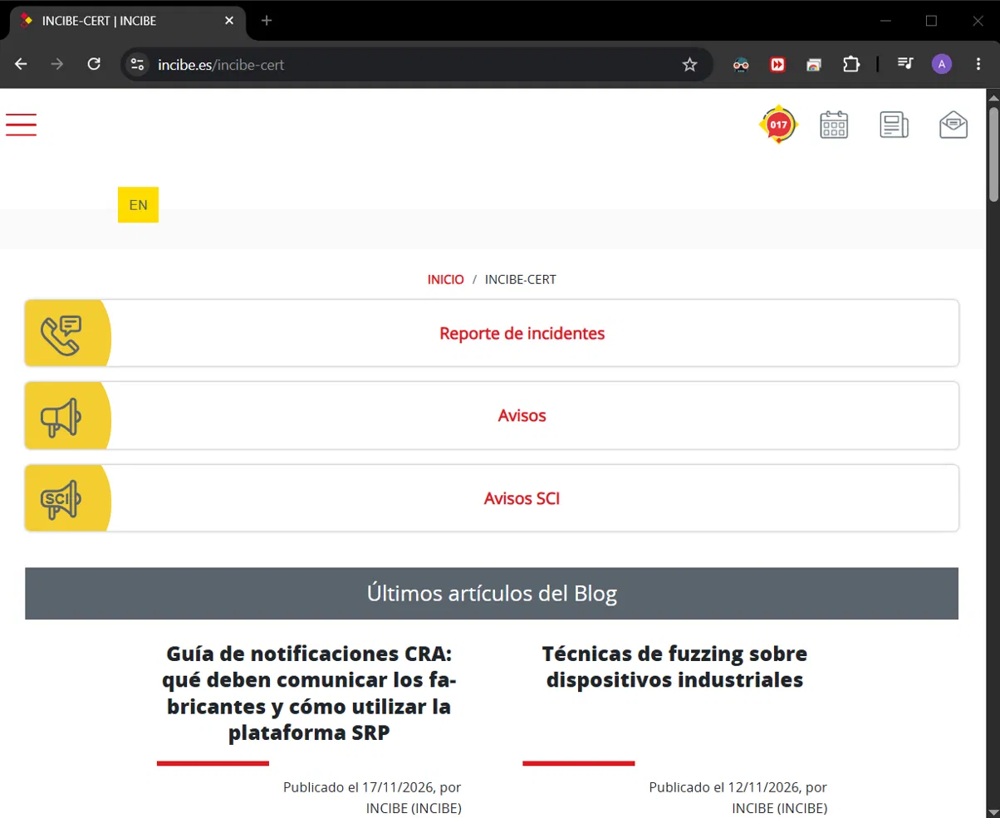
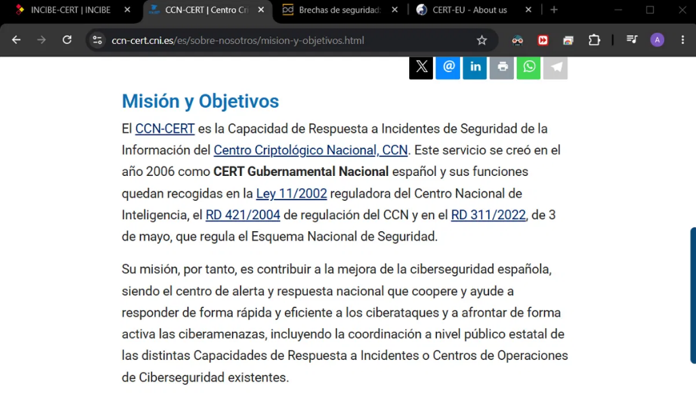
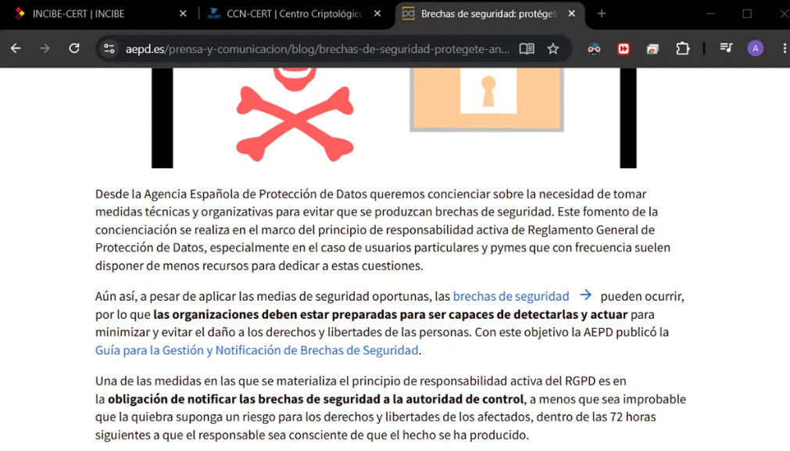
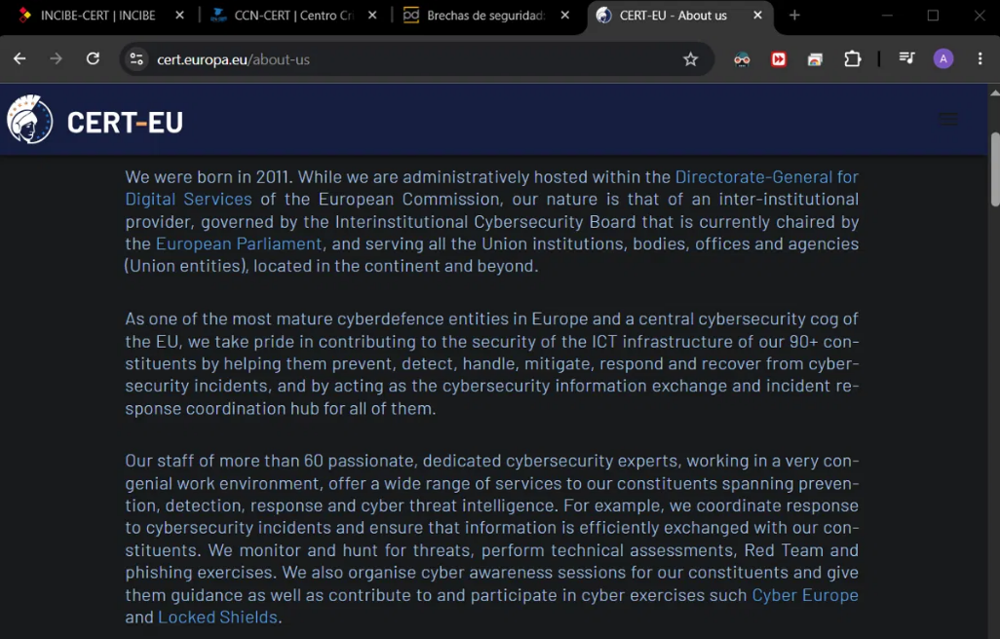

# 5. Notificación y organismos de respuesta

## 5.1 Modelo de comunicación interna del incidente

Principios: **mínimo necesario** (solo se informa a quien lo necesita), **un único portavoz**, información verificada y sin especulaciones, y canal alternativo si el correo corporativo puede estar comprometido (teléfono o mensajería segura).

| **Destinatario** | **Contenido** | **Canal** | **Cuándo** |
|---|---|---|---|
| Equipo de respuesta (CSIRT interno) | Detalle técnico completo, tareas y turnos | Canal seguro / reunión | Inmediato y continuo |
| Dirección general y DPO | Resumen de situación, impacto, riesgo legal, decisiones que se requieren | Llamada + informe breve | En 1 h y cada vez que haya cambios |
| Resto de empleados | Instrucciones prácticas (qué hacer y qué no), sin detalles técnicos | Comunicado de TI | Cuando se contenga lo esencial |
| Empleados afectados (receptores del correo) | Pasos concretos: no abrir, desconectar, cambiar claves, avisar | Llamada o presencial | Inmediato |
| Comunicación / atención al cliente | Mensaje oficial preparado, preguntas frecuentes | Reunión | Tras valorar la brecha |

### Plantilla A. Aviso interno inicial al equipo de respuesta y a la dirección

```text
ASUNTO: [CONFIDENCIAL] INC-2026-001 - Incidente de seguridad en curso
Fecha y hora: 16/11/2026 11:40     Elaborado por: Adrián Fuente, Resp. Ciberseguridad
RESUMEN: Se ha detectado la ejecución de un adjunto malicioso recibido por correo
(falso mensaje de RR. HH.) en el equipo WS-ADM-07, con conexiones salientes a IP
externas y accesos sospechosos a la carpeta de clientes.
GRAVEDAD: Alta (potencialmente crítica). Prioridad P1.
IMPACTO CONOCIDO: 1 equipo afectado. 13 equipos más en revisión.
RIESGO: Posible fuga de datos personales de clientes (pendiente de confirmar).
ACCIONES EN CURSO: aislamiento del equipo, bloqueo de IOC, preservación de evidencias.
SE REQUIERE: reunión de crisis a las 12:15 (sala de reuniones / videollamada).
INSTRUCCIONES: no reenviar este mensaje. No comentar el incidente fuera del equipo.
PRÓXIMA ACTUALIZACIÓN: 13:30 o antes si hay novedades.
```

### Plantilla B. Comunicado a todos los empleados

```text
ASUNTO: Aviso de seguridad: correo falso de "Recursos Humanos"
Hola a todos:
Hoy se ha recibido un correo fraudulento con el asunto "Actualización de nómina -
acción requerida". NO es de Recursos Humanos.
- Si NO lo has abierto: elimínalo y no hagas clic en nada.
- Si LO HAS ABIERTO o has habilitado macros: desconecta el equipo de la red SIN
  apagarlo y llama ya a TI (ext. 1234). No pasa nada por avisar.
- No uses el correo para comentar el incidente; contacta con TI.
Gracias por vuestra colaboración. Seguiremos informando.
Seguridad TI
```

### Plantilla C. Resumen para la dirección y el DPO (decisión sobre notificación)

| **Campo** | **Contenido** |
|---|---|
| **Hechos conocidos** | Ejecución de malware, conexiones C2, intentos de acceso a datos de clientes |
| **Datos potencialmente afectados** | Categorías, nº aproximado de clientes y registros, sensibilidad |
| **Evidencias de exfiltración** | Volumen saliente, ficheros accedidos, confirmado / no confirmado |
| **Riesgo para los afectados** | Valoración (bajo / medio / alto) y justificación |
| **Decisiones requeridas** | Notificación a la AEPD, comunicación a afectados, denuncia, contratación de apoyo externo |
| **Plazo** | Momento de conocimiento: 16/11/2026 12:40. Límite de 72 h: 19/11/2026 12:40 |

## 5.2 Notificación de una brecha de datos personales a la AEPD

El Reglamento General de Protección de Datos (RGPD, Reglamento UE 2016/679) y la LOPDGDD (Ley Orgánica 3/2018) definen una **violación de la seguridad de los datos personales** como la destrucción, pérdida o alteración accidental o ilícita de datos personales, o la comunicación o acceso no autorizados a ellos.

- **Cuándo notificar a la AEPD (art. 33 RGPD):** cuando exista una brecha de seguridad que afecte a datos personales, **salvo que sea improbable que suponga un riesgo** para los derechos y libertades de las personas.
- **Plazo:** sin dilación indebida y, si es posible, **en un máximo de 72 horas** desde que el responsable tiene constancia de la brecha. Si se supera, hay que justificar el retraso. Se admite notificación **por fases** si no se dispone de toda la información.
- **Contenido mínimo:** naturaleza de la brecha (categorías y nº aproximado de afectados y de registros), datos de contacto del DPO, posibles consecuencias y medidas adoptadas o propuestas.
- **Comunicación a los afectados (art. 34):** cuando la brecha entrañe un **alto riesgo**, se debe informar a los interesados «sin dilación indebida», en lenguaje claro. Excepciones: datos cifrados ininteligibles, medidas posteriores que eliminan el riesgo, o esfuerzo desproporcionado (con comunicación pública).
- **Registro interno (art. 33.5):** toda brecha, se notifique o no, debe documentarse (hechos, efectos y medidas).
- **Encargados del tratamiento:** deben avisar al responsable sin dilación indebida (art. 33.2).
- **Cómo:** a través de la sede electrónica de la AEPD (formulario de notificación de brechas). La AEPD ofrece una guía sobre gestión y notificación de brechas y una herramienta orientativa de ayuda a la decisión («Asesora Brecha»).

### Aplicación al caso

En este incidente hay indicios razonables de acceso no autorizado y posible exfiltración de datos personales de clientes (identificación, contacto y, posiblemente, facturación). Mientras no se pueda **descartar** el acceso a esos datos, se trata como brecha potencial. El reloj de las 72 horas empieza cuando existe **certeza razonable** de que ha habido compromiso de datos personales (no al inicio del incidente), pero se documenta cuándo y por qué se llegó a esa conclusión. Si se confirma la extracción de datos no cifrados y con información identificativa y financiera, el riesgo es alto: **se notifica a la AEPD y se comunica a los clientes afectados**. Si el análisis de logs demuestra que no se accedió a datos personales, se registra internamente la decisión de no notificar, razonada.

> **Qué haría yo**
>
> Activar al DPO desde la primera hora, abrir el registro de brechas, fijar la hora de conocimiento, preparar una notificación inicial a la AEPD dentro de las 72 h con los datos disponibles y completarla por fases. En paralelo, valorar denuncia ante las Fuerzas y Cuerpos de Seguridad (Policía Nacional o Guardia Civil) y avisar a la aseguradora de ciberriesgos y a los clientes con obligaciones contractuales de aviso.

## 5.3 Organismos CERT/CSIRT y sus funciones

Un **CERT/CSIRT** (Computer Emergency / Security Incident Response Team) es un equipo especializado en prevenir, detectar, analizar y responder a incidentes de ciberseguridad. Sus funciones habituales son: gestión y coordinación de incidentes, alerta temprana y avisos de vulnerabilidades, análisis de malware y forense, apoyo técnico a las víctimas, difusión de buenas prácticas y formación, y cooperación nacional e internacional.

| **Equipo** | **Ámbito** | **Funciones y utilidad para la empresa** |
|---|---|---|
| INCIBE-CERT (Instituto Nacional de Ciberseguridad) | España: ciudadanos, empresas (pymes) y entidades privadas; operadores de ámbito no público | Notificación y gestión de incidentes de empresas, avisos y vulnerabilidades, línea de ayuda en ciberseguridad (017), recursos para pymes. Es el equipo de referencia para Soluciones Delta. |
| CCN-CERT (Centro Criptológico Nacional) | España: Administraciones públicas, empresas y organizaciones estratégicas o críticas; Esquema Nacional de Seguridad | Respuesta a incidentes en el sector público y entidades críticas, guías CCN-STIC, herramientas (LUCIA, CARMEN, MARIA), alertas. Solo recurriría la empresa si fuera proveedor de la Administración o infraestructura crítica. |
| CERT-EU | Unión Europea: instituciones, órganos y agencias | Respuesta a incidentes e inteligencia para las instituciones de la UE. Referente de cooperación europea. |
| Red de CSIRT de la UE / ENISA | Estados miembros de la UE | Coordinación entre los CSIRT nacionales según la Directiva NIS2 y apoyo de la Agencia de Ciberseguridad de la UE (ENISA). |
| FIRST (Forum of Incident Response and Security Teams) | Internacional | Comunidad global de equipos de respuesta; intercambio de información y estándares. |
| CISA (EE. UU.) | EE. UU., con alcance internacional por su información | Alertas, guías y listas de vulnerabilidades explotadas conocidas (KEV); útil como fuente de inteligencia. |

> **Los dos equipos que investigué y a los que recurriría**
>
> **1) INCIBE-CERT**, por ser el equipo para empresas privadas en España, con canal de notificación de incidentes y línea 017. **2) CCN-CERT**, como referente nacional técnico (guías CCN-STIC, análisis de amenazas y colaboración) y obligatorio si la empresa fuera proveedor de organismos públicos. Como alternativa internacional investigué **CERT-EU**. Consulté sus webs oficiales y la de la AEPD el 23/11/2026 (capturas 5.1 a 5.4); ante un incidente real habría que comprobar de nuevo el procedimiento de contacto vigente.



**Captura 5.1.** *Web de INCIBE-CERT (incibe.es/incibe-cert): accesos a «Reporte de incidentes», «Avisos» y «Avisos SCI», y teléfono 017 de ayuda en ciberseguridad.*



**Captura 5.2.** *Web del CCN-CERT, página «Misión y Objetivos»: capacidad de respuesta a incidentes del Centro Criptológico Nacional, CERT gubernamental nacional creado en 2006.*



**Captura 5.3.** *Web de la AEPD, información sobre brechas de seguridad: obligación de notificar a la autoridad de control en las 72 horas siguientes a tener conocimiento, salvo que sea improbable un riesgo para los afectados, y formulario en la Sede Electrónica.*



**Captura 5.4.** *Web de CERT-EU (cert.europa.eu/about-us): equipo de respuesta a incidentes de las instituciones, órganos y agencias de la Unión Europea.*
